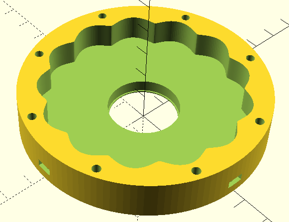

# vptc-calc
Калькулятор ВПТК (Волновой редуктор с роликами)

## Робот-собака: стопа, ходьба и бег

Текущая печатная голень со стопой, шаг **200 мм** и последовательная сборка:
одна нога → левая пара → четыре ноги с корпусом → бег. GIF замедлены:
**12 секунд на цикл**, круговой облёт — **48 секунд** на четыре цикла.
Направление вперёд в боковом виде — влево. Номера стоп помогают следить за ногами.
Модели OpenSCAD и настройки — в [описании стопы](output/foot/README.md).

<details>
<summary>1. Одна нога · шаг 200 мм</summary>


</details>

<details>
<summary>2. Левые передняя и задняя</summary>


</details>

<details open>
<summary>3. Четыре ноги с исходным корпусом</summary>


</details>

<details>
<summary>4. Бег диагональными парами</summary>


</details>

<details>
<summary>5. Бег с круговым облётом камеры</summary>


</details>

## Запуск

```
docker build -t vptc-calculator .
```

```
docker run --rm -it \
  -v "$(pwd)/calc-vpts.py":/app/calc-vpts.py:ro \
  -v "$(pwd)/encoder_scad.py":/app/encoder_scad.py:ro \
  -v "$(pwd)/output":/app/output \
  vptc-calculator
```

## Описание

Калькулятор генерирует 3D-модель волнового редуктора с роликами (VPTC - Variable Pace Traction Coupling) с параметрами, задаваемыми пользователем. В папку output помещается файл vptc_roller.scad который необходимо открыть в программе OpenSCAD.

Существующие файлы защищены от перезаписи. Для нового результата укажите `--output`,
а для намеренной перезаписи выбранного файла — `--overwrite`.

### Варианты с абсолютным энкодером

Генератор теперь содержит новые зажим, оба соединителя, основание крышки, лицевую
крышку и сборку с подшипником/сепаратором. Исходные модули деталей и режим `legacy`
сохранены. Пример без интерактивного ввода:

```sh
python calc-vpts.py --resolution 600 --ratio 19 --roller-d 4 --roller-h 5 \
  --rout 28 --diameter 70 --part encoder_assembly \
  --output output/encoder_reducer_generated.scad
```

Рядом сохраняется `*.encoder.json`: размеры колец, положение датчиков/крепежа,
контур платы и осевые размеры для будущей генерации платы. Ни один файл ручных
вариантов в `output` генератор не читает и не изменяет.

Доступные значения `--part`:

| Значение | Результат |
| --- | --- |
| `legacy` | Исходная модель ноги |
| `encoder_assembly`, `encoder_section`, `encoder_exploded` | Сборка, разрез, разнесённая сборка |
| `encoder_cap`, `encoder_lid`, `encoder_print` | Основание, лицевая крышка, обе детали для печати |
| `encoder_clamp`, `encoder_clamp_half` | Собранный зажим, одна печатная половина |
| `encoder_connector`, `encoder_load_connector` | Соединитель редуктора, соединитель другой детали |
| `encoder_pcb` | Механический контур платы |

В OpenSCAD выбор можно менять переменной `generated_part`. Варианты энкодера Ø70
по умолчанию используют угол основных отверстий **39°**, чтобы совпасть с текущей
KiCad-платой. Режим `legacy` сохраняет прежний поиск угла. Явный `--hole-angle` задаёт
свой угол; генератор предупреждает, если готовая плата Ø70 ему не соответствует.

Количество магнитов выбирается как максимальная чётная пара при перемычке не менее
0,6 мм между посадками Ø5,2. Внутреннее кольцо содержит на одну пару полюсов меньше:
для Ø70 получается **24/26**, для Ø80 — **30/32**. Радиусы, длина шейки и осевой подъём
вычисляются из размеров: в текущем Ø70 сепаратор и подшипник подняты на 0,5 мм,
шейка соединителя имеет длину **7,15 мм**.
Под максимальный корпус MCU 5,1×5,1 мм предусмотрен локальный карман с зазором
0,2 мм по сторонам и 0,15 мм снизу. Для Ø70 дно кармана находится на Z10,25,
выше неизменённого подшипникового упора Z10.

Плата в генерируемом SCAD — механический макет. Другой диаметр или расположение
отверстий требует новой электрической разводки. Подъём сепаратора ещё требует
проверки его окон роликов и сопряжения с 688ZZ в полной сборке редуктора.
У открытых поверхностей вычитания выступают на 0,01 мм; глухие глубины и упор
подшипника сохранены.

Проверки генератора: `python -m unittest discover -s tests -v`. Если установлен
OpenSCAD, они также проверяют компиляцию всех новых вариантов Ø70/Ø80 и реальную
геометрию упора подшипника, дна потая и локального кармана MCU.
Путь CLI можно задать переменной `OPENSCAD`.

## Генерируемые детали

Программа генерирует следующие основные детали:

### 1. Жёсткое колесо (Corpus редуктора) - `rigid_gear()`
- Внешний корпус редуктора с профильными впадинами
- Имеет крепёжные отверстия группы A (для крепления крышки)
- Имеет крепёжные отверстия группы B (для кожуха мотора)
- Посадочное место под подшипник 6803ZZ в корпусе


### 2. Корпус с боковым креплением - `rigid_gear_with_bracing()`
- Усиленная версия жёсткого колеса с дополнительными элементами бокового крепления

### 3. Сепаратор - `separator()`
- Держатель роликов с фланцем под основной подшипник
- Имеет посадочное место под подшипник 688ZZ (8x16x5) на конце
- Содержит отверстия для роликов
- Имеет крепёжные отверстия для нагрузки

### 4. Ролики - `rollers()`
- Цилиндрические ролики, размещаемые в сепараторе
- Количество определяется передаточным числом

### 5. Эксцентрик - `eccentric()`
- Эксцентриковая деталь, обеспечивающая волновую передачу
- Имеет посадочное место под подшипник 6803ZZ

### 6. Вал эксцентрика - `eccentric_shaft()`
- Основной вал с эксцентриковой ступенью
- Содержит посадочные места под подшипники
- Имеет шип для крепления сепаратора

### 7. Крышка редуктора - `cap()`
- Крышка корпуса с отверстиями для крепления
- Потайные отверстия под винты М3

### 8. Крышка с боковым креплением - `cap_with_bracing()`
- Усиленная версия крышки с элементами бокового крепления

### 9. Защитный кожух мотора - `motor_cover()`
- Защитный кожух для двигателя с креплением
- Имеет отверстия для крепления двигателя
- Центральное отверстие под магнит энкодера

### 10. Соединитель редукторов - `reducer_connector()`
- Элемент для соединения нескольких редукторов

### 11. Зажим соединителей - `connector_clamp()`
- Крепежный элемент для соединителей

## Управление сборкой

Внизу, в секции "Сборка", перечисляются детали, можно их создание раскомментировать и подвигать функцией translate:

```
// === Сборка ===
rigid_gear_with_bracing();  // Корпус с боковым креплением
translate([0, 0, h_reducer+1]) cap_with_bracing();  // Крышка с боковым креплением
translate([0, 0, 0.5]) eccentric_shaft();
translate([0, 0, 14]) rotate([180,0,0]) eccentric();
translate([0, 0, ecc_shaft_h1 + ecc_spacer_h-1]) separator();
translate([0, 0, -mc_total_height-1]) motor_cover(); // кожух снизу
```

## Параметры моделирования

Параметр $fn отвечает за разрешение геометрии модели:
```
// ВПТК редуктор с роликами

$fn = 60;  // Рекомендуемое значение для 3D печати
```

В редакторе OpenSCAD есть кнопки рендеринга и экспорт в STL.

## Параметры, запрашиваемые при запуске

- **Количество точек построения профиля жесткого колеса** (по умолчанию: 600) - влияет на точность профиля
- **Передаточное число** (по умолчанию: 19) - основной параметр передачи
- **Диаметр роликов (мм)** (по умолчанию: 4.0) - диаметр роликов сепаратора
- **Высота роликов (мм)** (по умолчанию: 5.0) - высота роликов сепаратора
- **Внешний радиус впадин жесткого колеса (мм)** (по умолчанию: 29.0) - радиус профиля жесткого колеса
- **Внешний диаметр редуктора (мм)** (по умолчанию: 70.0) - общий диаметр корпуса

## Список деталей и крепежа

Программа автоматически выводит список всех необходимых деталей и крепежа, включая:
- Подшипники: 6803ZZ (17×26×5 мм), 688ZZ (8×16×5 мм), и подшипник для сепаратора (6808-2RS или 6810-2RS)
- Винты: M3×10 мм и M3×15 мм
- Гайки: M3
