# vptc-calc
Калькулятор ВПТК (Волновой редуктор с роликами)

## Сохранённая плата энкодера

Текущая электрическая плата **CAN V2.4 / D70** находится в [electronics/encoder_can_v2](electronics/encoder_can_v2/README.md). Это фиксированный вариант под конкретную геометрию редуктора Ø70 мм, подшипник 40×52×7 мм и фазу сборочных отверстий 39°. Она имеет четыре слоя и толщину 0,8 мм; варианты другой толщины или с двумя слоями не входят в эту ревизию. Размерная привязка и параметры эталонной сборки — [MECHANICAL_VARIANT.md](electronics/encoder_can_v2/MECHANICAL_VARIANT.md).

## Запуск

Основной `calc-vpts.py` создаёт **полный комплект CAD**: сборки, отдельные
печатные детали, библиотеки геометрии и список деталей. Для текущего Ø70:

```sh
python3 calc-vpts.py --resolution 600 --ratio 19 --roller-d 4 --roller-h 5 \
  --rout 28 --diameter 70 --part knee_assembly \
  --output output/generated/robot.scad
```

Требуется Python с `numpy`. Результат:

- `robot.scad` — общий файл; `generated_part` выбирает сборку или деталь;
- `robot_assets/` — все необходимые библиотеки, включая текущую стопу;
- `robot_print/` — **37 отдельных заданий** с названиями деталей;
- `robot_print/README.md` — количество на узел, материалы и порядок сборки;
- `robot.encoder.json` — размеры, совместимость PCB, перечень деталей и хеши файлов.

Все эти файлы генерируются одним запуском. `--part` выбирает начальное отображение,
а не ограничивает состав комплекта. Папки `robot_assets` и `robot_print` должны
переноситься вместе с `robot.scad`; сохранённых STL или моделей из `output` для
работы генератора не требуется. При повторной генерации нужен `--overwrite`;
защищён каждый файл комплекта, включая библиотеки и отдельные задания печати.

Чтобы сразу получить STL всех печатных вариантов, добавить `--export-stl` к команде.
Нужен установленный OpenSCAD; путь можно передать через `--openscad`. Для отдельных
STL добавить, например, `--export-stl --stl-part encoder_magnet_ring_half --stl-part knee_magnet_ring`.
Файлы появятся рядом с соответствующими SCAD. Исходные варианты и запасные детали
включены в каталог отдельно: печатать весь каталог как комплект одной ноги не нужно.
Количество указано **на узел**, а не на всю собаку; `assemblies` в JSON группирует
детали по назначению.

Автоматический экспорт использует двоичный STL и проверяет замкнутость сетки
и направление граней. Численные вырождения экспорта устраняются с округлением
не более 0,00001 мм; если сетка остаётся незамкнутой, экспорт завершается ошибкой.
Подробности рендера и проверки сохраняются в `*_print/.build/`.

Для правок использовать `calc-vpts.py`, `encoder_scad.py` и исходники в
[`cad/`](cad/README.md), затем повторять генерацию. В `cad/` перенесены принятые
модели редуктора V2, колена с двумя опорами полукольца и текущей стопы.
Для штатного Ø70 плата загружается из сохранённых механических данных KiCad V2;
хеш исходной PCB проверяется перед генерацией. Для другого диаметра рассчитывается
механический вариант редуктора; готовая PCB V2 и колено автоматически не масштабируются.

В исходной механике остаётся осевое пересечение ушка тяги и короткого плеча
шарнира на 0,5 мм. Генератор его сохраняет; это нужно исправить до сборки.
Перенос моделей в генератор не является подтверждением прочности или точности энкодера.

Альтернатива — Docker (с OpenSCAD для экспорта STL):

```
docker build -t vptc-calculator .
```

```
docker run --rm -it \
  -v "$(pwd)":/app -w /app \
  vptc-calculator
```

## Описание

Калькулятор генерирует 3D-модель волнового редуктора с роликами (VPTC - Variable Pace Traction Coupling) с параметрами, задаваемыми пользователем. В папку output помещается файл vptc_roller.scad который необходимо открыть в программе OpenSCAD.

Существующие файлы защищены от перезаписи. Для нового результата укажите `--output`,
а для намеренной перезаписи выбранного файла — `--overwrite`.

### Варианты деталей редуктора для установки энкодера

Для установки абсолютного энкодера предусмотрены доработанные варианты
крышки редуктора, зажима соединителей и обоих соединителей, а также защитная
накладка крышки. Плата и носитель магнитов входят в эту сборку как компоненты
энкодера. Исходные модули деталей и режим `legacy` сохранены. Пример без
интерактивного ввода:

```sh
python calc-vpts.py --resolution 600 --ratio 19 --roller-d 4 --roller-h 5 \
  --rout 28 --diameter 70 --part encoder_assembly \
  --output output/encoder_reducer_generated.scad
```

Рядом сохраняется `*.encoder.json`: размеры колец, положение датчиков/крепежа,
контур платы и осевые размеры для будущей генерации платы. Ни один файл ручных
вариантов в `output` генератор не читает и не изменяет.

Доступные значения `--part`:

| Значение | Результат |
| --- | --- |
| `legacy` | Исходная сборка и модули робота |
| `encoder_assembly`, `encoder_section`, `encoder_exploded` | Сборка, разрез, разнесённая сборка |
| `encoder_cap`, `encoder_lid`, `encoder_print` | Крышка редуктора под энкодер, её защитная накладка, обе детали для печати |
| `encoder_clamp`, `encoder_clamp_half` | Доработанный зажим соединителей под энкодер, одна печатная половина |
| `encoder_magnet_ring`, `encoder_clamp_print` | Отдельные половинки кольца со сквозными отверстиями, две половины стоя и обе половинки кольца плашмя |
| `encoder_connector`, `encoder_load_connector` | Выходной соединитель и соединитель нагрузки редуктора, доработанные под энкодер |
| `encoder_pcb` | Механический контур платы |
| `reducer_complete` | Полный редуктор с крышкой V2, сепаратором, подшипниками и соединителями |
| `leg_assembly` | Нога с текущим коленом V2 и стопой; анимация в пределах проверенного хода колена |
| `knee_assembly`, `knee_section`, `knee_exploded` | Сборка колена, разрез и разнесённый вид |
| `knee_mount`, `knee_stage` | Две опоры полукольца и этапы сборки колена |
| `knee_hip`, `knee_lower`, `knee_shin`, `knee_cover`, `knee_magnet_ring` | Печатные детали колена с платой V2 |
| `encoder_magnet_ring_half` | Одна одинаковая половинка кольца редуктора для печати плашмя |
| `foot_rigid`, `foot_sole`, `foot_cuff` | Текущая стопа с зажимом, TPU-накладка и запасной зажим |
| `body_front`, `body_rear`, `body_battery` | Отдельные секции корпуса робота |

В OpenSCAD выбор можно менять переменной `generated_part`. Все варианты редуктора Ø70
по умолчанию используют угол основных отверстий **39°**, чтобы совпасть с текущей
KiCad-платой и взаимно соответствовать в одном комплекте. Явный `--hole-angle` задаёт
свой угол; генератор предупреждает, если готовая плата Ø70 ему не соответствует.

Колено: `animate=false` включает ручное управление `knee_angle`; при `animate=true`
работает OpenSCAD **Вид → Анимировать**. При `$t=0` отображается заданный угол.
Печатные задания не двигаются при анимации. `legacy` сохраняет прежнюю компоновку
робота, заменяя зависимости от внешних STL процедурными модулями; новые колено
и полная нога представлены отдельными режимами.

Количество магнитов выбирается как максимальная чётная пара при перемычке не менее
0,6 мм между посадками Ø5,2. Внутреннее кольцо содержит на одну пару полюсов меньше:
для Ø70 получается **24/26**, для Ø80 — **30/32**. Радиусы, длина шейки и осевой подъём
вычисляются из размеров: в текущем Ø70 сепаратор и подшипник подняты на 0,5 мм,
шейка соединителя имеет длину **6,75 мм**.
Магнитные посадки вынесены в отдельное кольцо толщиной **0,8 мм** со
сквозными отверстиями Ø5,2, которое печатается двумя одинаковыми половинками
плашмя — по одной на каждую половину зажима. Плоский торец полузажима снижен
с Z12 до Z11,6; верхняя стенка стала тоньше на 0,4 мм. Кольцо занимает
Z11,6–12,4, поэтому положение магнитов и длины соединителей сохранены.
Печатаются две одинаковые половины корпуса зажима и две одинаковые половинки
кольца. Половинку приклеивают к торцу своей половины зажима; толщину клеевого
слоя нужно учитывать при установке.
Для отдельной печати одной половинки есть
`output/connector_clamp_magnet_ring_half_0p8.scad` (нужно два экземпляра).
В каждой половинке Ø70 — 12 внутренних и 13 наружных отверстий. Пластик одинаковый,
но полярность первого магнита наружного ряда у второй половинки противоположная;
у внутреннего ряда — одинаковая. Чередование N/S сохраняется через оба стыка.
Произвольный общий поворот собранного зажима учитывается привязкой к известному
положению сустава (упор или сборочный шаблон) с сохранением смещения нуля.
После переустановки зажима эту привязку повторяют. Установочные метки либо
однозначный механический упор полезны для повторяемости сборки; они не заменяют
проверку погрешности энкодера. Неправильную полярность отдельных магнитов одной
поправкой нуля исправить нельзя.
Под максимальный корпус MCU 5,1×5,1 мм предусмотрен локальный карман с зазором
0,2 мм по сторонам и 0,15 мм снизу. Для Ø70 дно кармана находится на Z10,25,
выше неизменённого подшипникового упора Z10.

Для штатного Ø70 генератор использует контур, два крепления и компоненты
разведённой компактной платы V2 (`electronics/encoder_can_v2`). Механические данные
читаются из `design/mechanics_v2.json`; хеш проверяется по сохранённой PCB.
Экспорт обновляется `scripts/export_mechanics.py` через Python KiCad.
Актуальная воспроизводимая сборка крышки — режим `encoder_assembly` основного генератора.
Сохранённый прежний файл: `output/reducer_cap_encoder_can.scad`.
Для других диаметров плата в генерируемом SCAD остаётся механическим макетом.
Другой диаметр или расположение отверстий требует новой электрической разводки. Подъём сепаратора ещё требует
проверки его окон роликов и сопряжения с 688ZZ в полной сборке редуктора.
У открытых поверхностей вычитания выступают на 0,01 мм; глухие глубины и упор
подшипника сохранены.

Проверки генератора: `python -m unittest discover -s tests -v`. Если установлен
OpenSCAD, они также проверяют компиляцию всех новых вариантов Ø70/Ø80 и реальную
геометрию упора подшипника, дна потая и локального кармана MCU.
Путь CLI можно задать переменной `OPENSCAD`.

## Генерируемые детали

Иллюстрированный каталог ниже показывает **29 ранее сохранённых деталей**.
Актуальный полный перечень, включая колено V2 и отдельные полукольца, создаётся
в `*_print/README.md` основным генератором.
На каждой картинке — геометрия соответствующего модуля OpenSCAD, а не эскиз.
Слева объёмный вид, справа вид вдоль локальной оси Z. Масштаб видов подбирается
отдельно; габарит XYZ указан под изображением. Размеры — в миллиметрах, углы — в градусах.

### Как получить и открыть отдельную деталь

Для каждой детали есть готовый файл в [docs/parts](docs/parts), который вызывает
ровно один модуль и скрывает остальную сборку. Ссылка «Открыть деталь» дана
в каждой карточке. Открыть этот `.scad` в OpenSCAD, нажать **F5** для просмотра,
**F6** для точного рендера, затем **Файл → Экспорт → STL**. Положение для
печати отдельно задано только там, где вызван модуль с суффиксом `_print`.

Картинки и файлы карточек используют сохранённый
[эталонный результат генератора](docs/parts/reference_model.scad):

```sh
python3 calc-vpts.py --resolution 600 --ratio 19 --roller-d 4 --roller-h 5 \
  --rout 28 --diameter 70 --hole-angle 39 --part encoder_assembly \
  --output output/my_reducer.scad
```

Для собственной версии создать рядом с результатом небольшой файл, например
`output/my_cap.scad`:

```scad
use <my_reducer.scad>
$fn=60;
cap();
```

Вместо `cap();` подставить вызов из нужной карточки. Для текущей стопы и TPU-опоры
использовать задания `foot_rigid.scad` и `foot_sole.scad` из созданного каталога `*_print/`.

### Где изменять параметры

| Уровень | Что менять | Когда пересчитывается |
| --- | --- | --- |
| CLI генератора | `--resolution`, `--ratio`, `--roller-d`, `--roller-h`, `--rout`, `--diameter`, `--hole-angle` | Повторным запуском `calc-vpts.py` с новым `--output` |
| Аргументы модулей | Например, `reducer_connector(h1=8,skirt=true)` или `shin(foot=false)` | Сразу при F5/F6 в файле отдельной детали |
| Переменные SCAD | Толщины, высоты, зазоры и размеры посадок в сгенерированном файле | После изменения самого файла, из которого импортируется модуль |
| Библиотека стопы | Переменные `h_*` в `cad/foots_h.scad` | После повторного запуска генератора |

**Профиль впадин, число роликов, координаты отверстий и часть размеров записываются
Python как готовые числа.** Одной замены `D_out` или `d_roller` в SCAD недостаточно:
для другой передачи или диаметра нужно повторно запустить генератор.
Переменные из файла, подключённого через `use`, не становятся переменными внешнего
файла: менять их нужно в исходном SCAD, а через вызов передавать только его аргументы.
Значения в таблицах ниже относятся к указанному эталону Ø70; это не универсальные
размеры для всех диаметров. Исходный генератор и его формулы — [calc-vpts.py](calc-vpts.py),
параметры доработок редуктора под энкодер — [encoder_scad.py](encoder_scad.py).

### Редуктор

#### 1. Жёсткое колесо / корпус

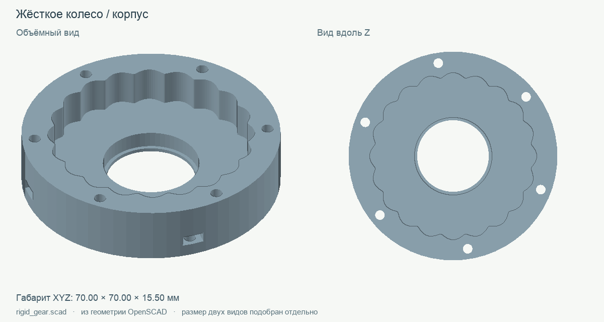

[Открыть деталь](docs/parts/rigid_gear.scad) · Источник: [reference_model.scad](docs/parts/reference_model.scad).

Вызов для отдельного файла:

```scad
rigid_gear();
```

Как построить: Создать цилиндр корпуса. Выдавить рассчитанный Python профиль впадин и вычесть его сверху. Вырезать отверстия A/B и ступенчатую посадку 6803ZZ.

| Параметр | Значение в эталоне | Что задаёт |
| --- | --- | --- |
| `D_out` | 70 | Наружный диаметр, из --diameter |
| `h_reducer` | 15.5 | Высота корпуса: h_roller + 10.5 |
| `h_cut` | 10 | Глубина профильной полости: h_roller + 5 |
| `--ratio / --resolution` | 19 / 600 | 20 впадин и число точек рассчитанного профиля |
| `motor_radius / motor_angles` | 32 / [54,144,234,324]° | Расположение отверстий B |

#### 2. Корпус с боковым креплением

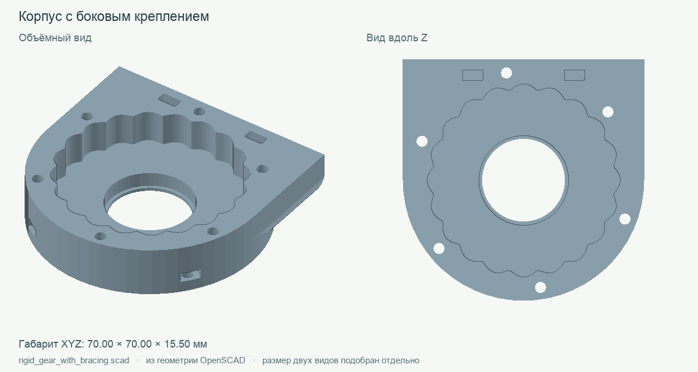

[Открыть деталь](docs/parts/rigid_gear_with_bracing.scad) · Источник: [reference_model.scad](docs/parts/reference_model.scad).

Вызов для отдельного файла:

```scad
rigid_gear_with_bracing();
```

Как построить: Взять rigid_gear(). Добавить боковой объём, двумя овальными конусами сформировать выемки, повторно прорезать отверстия B и отверстия бокового крепления.

| Параметр | Значение в эталоне | Что задаёт |
| --- | --- | --- |
| `bracing_offset_y` | 29 | Смещение крепления: D_out/2 − 6 |
| `bracing_offset_z` | 17.5 | Высота оси крепления: D_out/4 |
| `bracing_offset_x` | 2.2 | Значение в сгенерированном SCAD; 2.25 в Python округляется до одного знака |
| `side_long / side_short` | 29.564 / 12.246 | Расстояния между боковыми отверстиями |

#### 3. Сепаратор

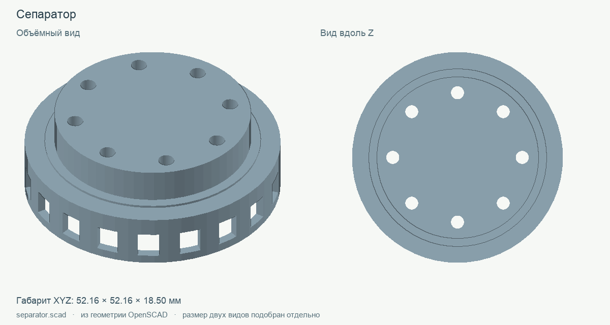

[Открыть деталь](docs/parts/separator.scad) · Источник: [reference_model.scad](docs/parts/reference_model.scad).

Вызов для отдельного файла:

```scad
separator();
```

Как построить: Создать цилиндр Rsep_out, вычесть внутреннюю полость Rsep_in. Сделать ступени фланца, посадку 688ZZ, радиальные окна под ролики и восемь крепёжных отверстий.

| Параметр | Значение в эталоне | Что задаёт |
| --- | --- | --- |
| `Rsep_m` | 25.2 | Радиус центров роликов |
| `Rsep_out / Rsep_in` | 26.08 / 24.32 | Наружный и внутренний радиусы сепаратора |
| `separator_h` | 9 | Основная высота: h_roller + 4 |
| `bearing_inner / bearing_outer` | 40 / 52 | Посадка выбранного 6808-2RS |
| `--ratio / h_roller` | 19 / 5 | Число окон / высота роликов |

#### 4. Ролики

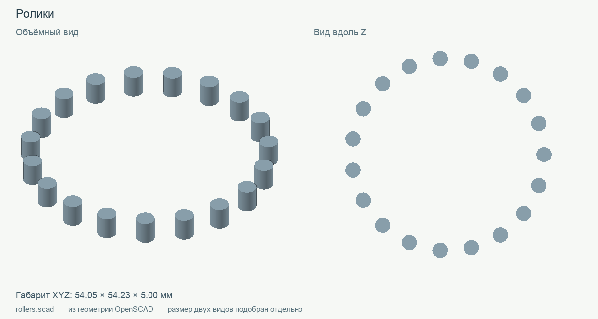

[Открыть деталь](docs/parts/rollers.scad) · Источник: [reference_model.scad](docs/parts/reference_model.scad).

Вызов для отдельного файла:

```scad
rollers();
```

Как построить: Построить цилиндр ролика с центром по Z. Разместить 19 копий на окружности Rsep_m поворотами с шагом 360/19.

| Параметр | Значение в эталоне | Что задаёт |
| --- | --- | --- |
| `d_roller / h_roller` | 4 / 5 | Диаметр / высота, из --roller-d и --roller-h |
| `Rsep_m` | 25.2 | Радиус расположения |
| `--ratio` | 19 | Количество роликов; пересчитывается в Python |

#### 5. Эксцентрик

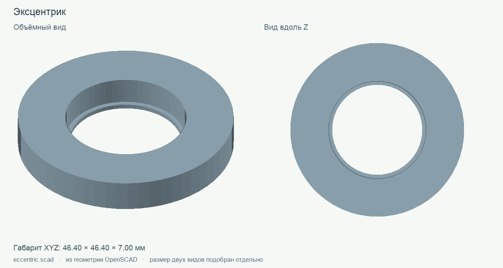

[Открыть деталь](docs/parts/eccentric.scad) · Источник: [reference_model.scad](docs/parts/reference_model.scad).

Вызов для отдельного файла:

```scad
eccentric();
```

Как построить: Создать диск радиуса rd. Вырезать проход Ø24 и посадку под 6803ZZ Ø26, оставив нижний упор. Смещение оси задаётся при установке детали в сборку.

| Параметр | Значение в эталоне | Что задаёт |
| --- | --- | --- |
| `rd` | 23.2 | Радиус диска; вычисляется и записывается в геометрию |
| `eccentric_h` | 7 | Толщина: h_roller + 2 |
| `eccentricity` | 0.8 | Смещение в сборке: 0.2 × d_roller |
| `посадка 6803ZZ` | Ø26 × 5 | Геометрия подшипника; Ø24 у нижнего упора |

#### 6. Вал эксцентрика

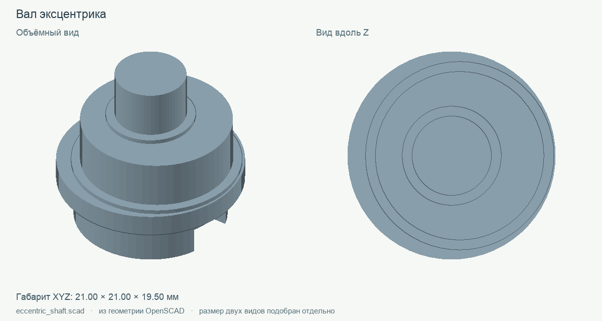

[Открыть деталь](docs/parts/eccentric_shaft.scad) · Источник: [reference_model.scad](docs/parts/reference_model.scad).

Вызов для отдельного файла:

```scad
eccentric_shaft();
```

Как построить: Объединить цилиндры основания, проставки, смещённой ступени и верхнего шипа. Вырезать осевое отверстие и два нижних паза.

| Параметр | Значение в эталоне | Что задаёт |
| --- | --- | --- |
| `ecc_shaft_h1` | 5 | Высота нижней ступени |
| `ecc_spacer_h` | 2.5 | Высота проставки |
| `ecc_shaft_h2` | 6 | Высота смещённой ступени |
| `ecc_pin_h` | 6 | Высота шипа Ø8 |
| `eccentricity` | 0.8 | Смещение средней ступени по X |

#### 7. Крышка редуктора

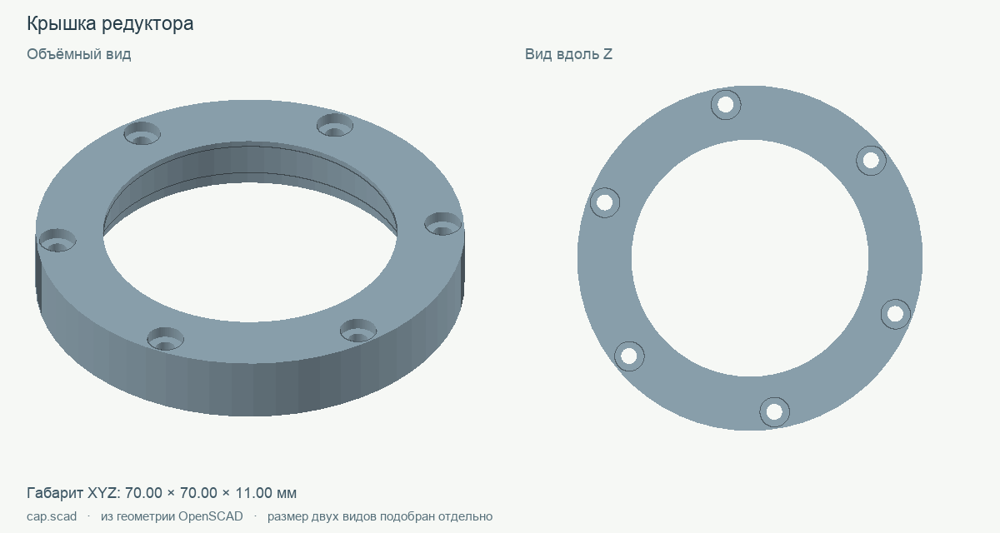

[Открыть деталь](docs/parts/cap.scad) · Источник: [reference_model.scad](docs/parts/reference_model.scad).

Вызов для отдельного файла:

```scad
cap();
```

Как построить: Создать диск D_out. Вырезать посадку наружного кольца подшипника, сквозное отверстие меньшего диаметра, нижнюю полость под сепаратор и отверстия A с потаями.

| Параметр | Значение в эталоне | Что задаёт |
| --- | --- | --- |
| `cap_thickness` | 11 | Общая толщина |
| `bearing_outer` | 52 | Диаметр посадки 6808-2RS |
| `bearing_width` | 7 | Ширина выбранного подшипника |
| `Rsep_out` | 26.08 | Радиус нижней полости = Rsep_out + 1 |
| `--hole-angle` | авто / 39° для энкодера Ø70 | Фаза группы A задаётся при генерации |

#### 8. Крышка с боковым креплением

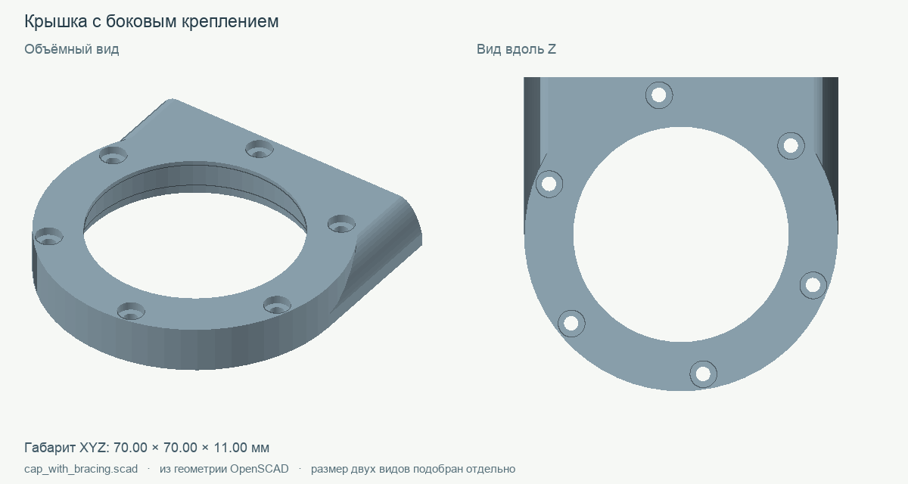

[Открыть деталь](docs/parts/cap_with_bracing.scad) · Источник: [reference_model.scad](docs/parts/reference_model.scad).

Вызов для отдельного файла:

```scad
cap_with_bracing();
```

Как построить: Добавить к cap() боковой объём, вычесть овальные конусы и внутренний цилиндр. Просверлить отверстия крепления и прорезать два паза у боковых опор.

| Параметр | Значение в эталоне | Что задаёт |
| --- | --- | --- |
| `D_out / cap_thickness` | 70 / 11 | Диаметр / толщина базовой крышки |
| `bracing_offset_x/y/z` | 2.2 / 29 / 17.5 | Положение боковой геометрии |
| `side_long / side_short` | 29.564 / 12.246 | Положение вырезов у боковых отверстий |

#### 9. Кожух мотора

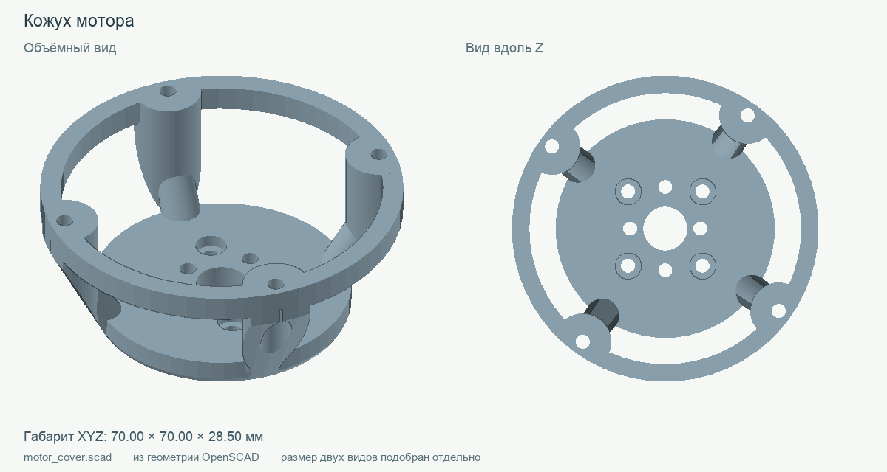

[Открыть деталь](docs/parts/motor_cover.scad) · Источник: [reference_model.scad](docs/parts/reference_model.scad).

Вызов для отдельного файла:

```scad
motor_cover();
```

Как построить: Объединить нижнюю площадку, наклонные стойки через hull(), вертикальные опоры и верхнее кольцо. Обрезать наружный габарит и вычесть отверстия двигателя, магнита, гаек и крепления B.

| Параметр | Значение в эталоне | Что задаёт |
| --- | --- | --- |
| `mc_motor_plate_d / mc_base_thickness` | 50 / 4 | Диаметр площадки / толщина плиты |
| `mc_total_height` | 27.5 | Высота, рассчитанная по осевой сборке |
| `mc_motor_hole_1 / mc_motor_hole_2` | 16 / 19 | Межосевые расстояния пар крепления мотора |
| `mc_encoder_hole_d` | 10 | Центральное отверстие |
| `mc_ring_width / mc_ring_height` | 4 / 5 | Ширина / высота верхнего кольца |

#### 10. Соединитель редукторов

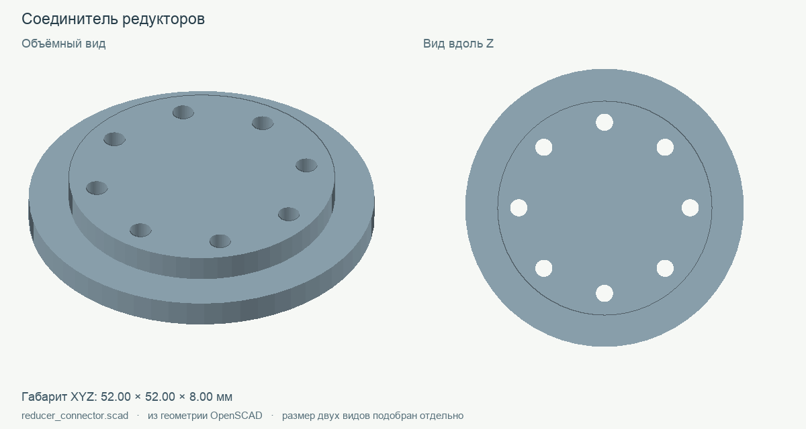

[Открыть деталь](docs/parts/reducer_connector.scad) · Источник: [reference_model.scad](docs/parts/reference_model.scad).

Вызов для отдельного файла:

```scad
reducer_connector(h1=4,skirt=false);
```

Как построить: Объединить нижний диск и цилиндрическую шейку. При skirt=true добавить коническую юбку. Вырезать восемь отверстий M3 и выбранные потаи.

| Параметр | Значение в эталоне | Что задаёт |
| --- | --- | --- |
| `h1` | 4 | Высота шейки, аргумент модуля |
| `skirt` | false | Включение юбки; для неё h1 > 3 |
| `fitting` | true | Потаи по умолчанию при holes=undef |
| `holes` | undef / массив из 8 значений | Индивидуальное включение потаев |
| `bearing_inner` | 40 | Диаметр шейки |

#### 11. Полузажим соединителей

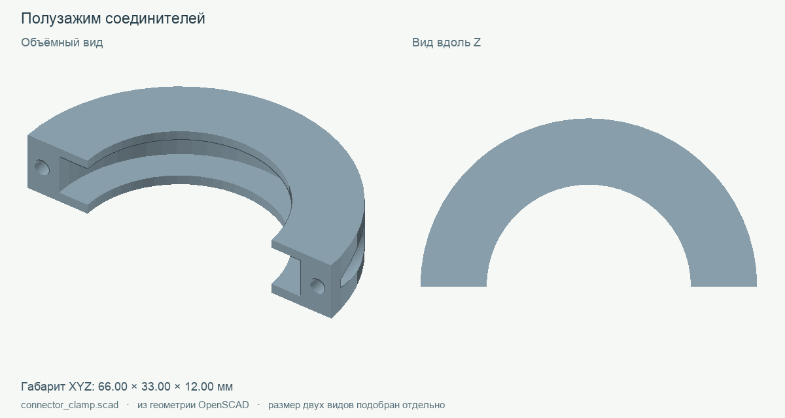

[Открыть деталь](docs/parts/connector_clamp.scad) · Источник: [reference_model.scad](docs/parts/reference_model.scad).

Вызов для отдельного файла:

```scad
connector_clamp();
```

Как построить: Вычесть из цилиндра центральный проход, внутреннюю кольцевую канавку и поперечные стяжные отверстия с местами под головки. Пересечь результат с полупространством Y≥0.

| Параметр | Значение в эталоне | Что задаёт |
| --- | --- | --- |
| `D_out` | 70 | Наружный диаметр полузажима = D_out − 4 |
| `bearing_inner` | 40 | Центральный проход |
| `высота / канавка` | 12 / 8.2 | Заданы внутри модуля; начало канавки Z=2 |
| `отверстия стяжки` | Ø3.2 / Ø6 | Сквозное / под головку |

### Редуктор с установленным энкодером

Здесь показаны варианты крышки редуктора, полузажима и соединителей, доработанные для установки энкодера. Носитель магнитов и плата указаны отдельно как компоненты самого энкодера.

#### 12. Крышка редуктора под установку энкодера

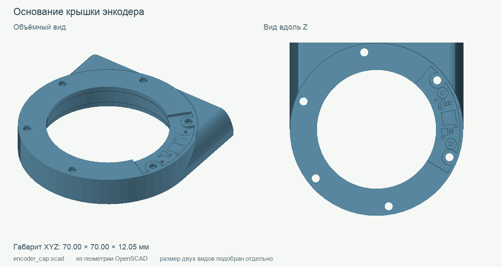

[Открыть деталь](docs/parts/encoder_cap.scad) · Источник: [reference_model.scad](docs/parts/reference_model.scad).

Вызов для отдельного файла:

```scad
cap_encoder();
```

Как построить: Взять крышку редуктора с боковым креплением, добавить опоры платы и вычесть карманы по контуру платы и габаритам компонентов. Положение креплений читается из механики V2 для совместимого Ø70.

| Параметр | Значение в эталоне | Что задаёт |
| --- | --- | --- |
| `with_bracing` | true | Аргумент: боковое крепление включено |
| `encoder_pcb_clearance` | 0.25 | Зазор контура платы |
| `encoder_mcu_xy_clearance / encoder_mcu_axial_clearance` | 0.2 / 0.15 | Боковой / осевой зазор под компоненты |
| `encoder_separator_lift` | 0.5 | Подъём сепаратора в сборке |
| `encoder_native_boundary / encoder_native_mounts` | из mechanics_v2.json | Контур и крепления совместимой платы |

#### 13. Защитная накладка крышки редуктора с энкодером

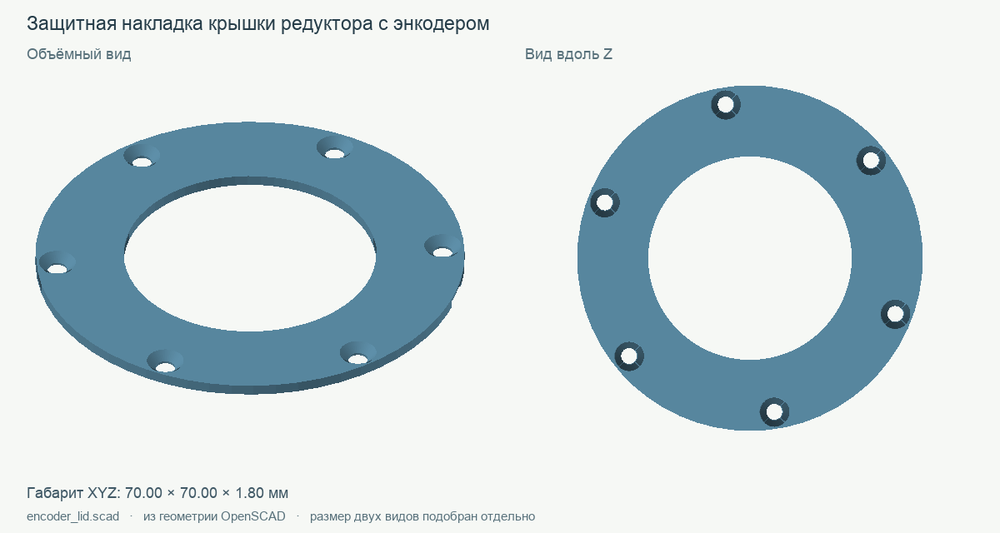

[Открыть деталь](docs/parts/encoder_lid.scad) · Источник: [reference_model.scad](docs/parts/reference_model.scad).

Вызов для отдельного файла:

```scad
encoder_selected_part("encoder_lid");
```

Как построить: Выдавить защитный контур над платой. Вырезать карманы под компоненты, крепёж и канал провода. Над датчиками оставить заданную толщину окна. Перенести деталь к Z=0 для просмотра и экспорта.

| Параметр | Значение в эталоне | Что задаёт |
| --- | --- | --- |
| `encoder_window_h` | 0.4 | Толщина окон над Hall-датчиками |
| `encoder_sensor_gap` | 0.2 | Осевой запас над габаритом датчика |
| `encoder_roof_extra_h` | 0.4 | Дополнительная высота основной крыши |
| `encoder_lid_base_z / encoder_lid_top_z` | из осевой сборки | Низ / верх крышки до переноса |

#### 14. Корпус полузажима соединителей под энкодер

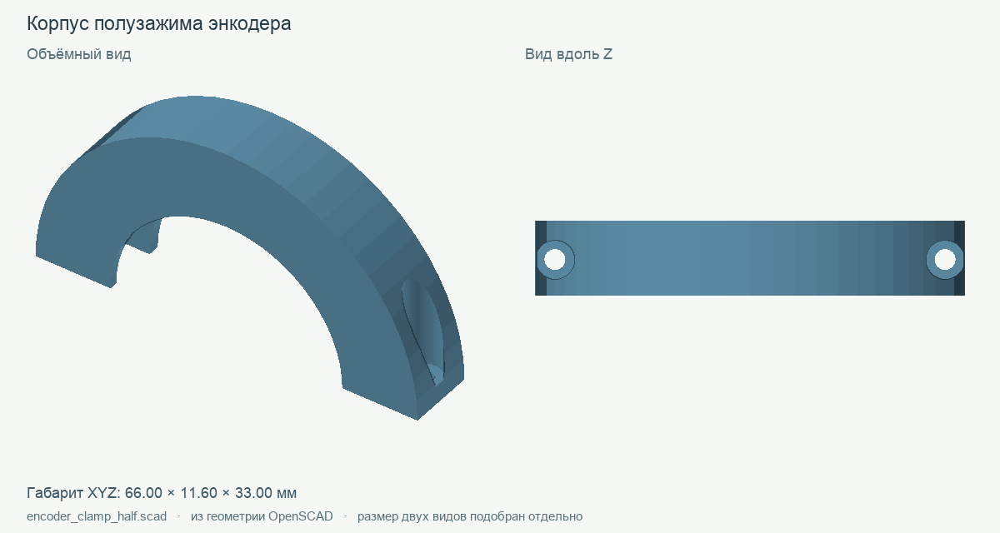

[Открыть деталь](docs/parts/encoder_clamp_half.scad) · Источник: [reference_model.scad](docs/parts/reference_model.scad).

Вызов для отдельного файла:

```scad
encoder_clamp_body_for_print();
```

Как построить: Взять обычный полузажим соединителей и срезать верх на глубину encoder_magnet_recess_depth для установки отдельного носителя магнитов. Повернуть корпус в штатное печатное положение.

| Параметр | Значение в эталоне | Что задаёт |
| --- | --- | --- |
| `encoder_clamp_h` | 12 | Полная исходная высота |
| `encoder_magnet_recess_depth` | 0.4 | Снижение торца корпуса |
| `encoder_clamp_body_h` | 11.6 | Остаточная высота корпуса |
| `D_out / bearing_inner` | 70 / 40 | Наружная геометрия / центральный проход |

#### 15. Носитель магнитов энкодера — половинка

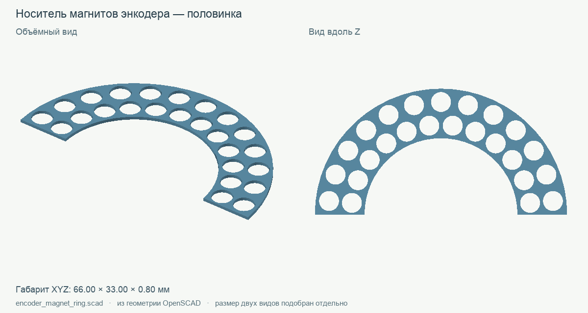

[Открыть деталь](docs/parts/encoder_magnet_ring.scad) · Источник: [reference_model.scad](docs/parts/reference_model.scad).

Вызов для отдельного файла:

```scad
encoder_magnet_ring_half_for_print();
```

Как построить: Создать плоское полукольцо и вырезать сквозные цилиндрические посадки двух дорожек. Центры равномерно распределить с половиной шага от стыка. Для сборки нужны две одинаковые половинки.

| Параметр | Значение в эталоне | Что задаёт |
| --- | --- | --- |
| `encoder_magnet_d / encoder_magnet_clearance` | 5 / 0.2 | Диаметр магнита / прибавка к диаметру отверстия |
| `encoder_rim_wall` | 0.6 | Минимальная перемычка при расчёте количества |
| `encoder_magnet_ring_h` | 0.8 | Толщина = recess_depth + rim_h |
| `encoder_track_radii` | 23.5 / 29.5 | Радиусы двух дорожек для Ø70 |
| `encoder_track_counts` | 24 / 26 | Полные количества; в половинке 12 / 13 |

#### 16. Выходной соединитель редуктора под энкодер

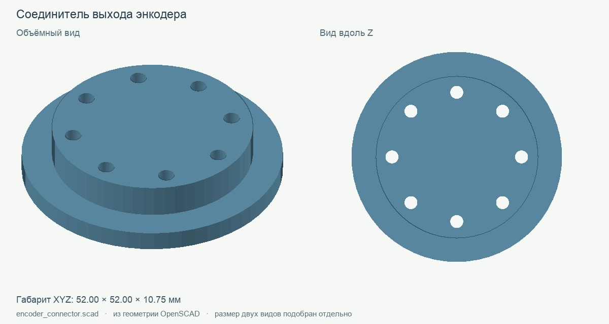

[Открыть деталь](docs/parts/encoder_connector.scad) · Источник: [reference_model.scad](docs/parts/reference_model.scad).

Вызов для отдельного файла:

```scad
reducer_connector_encoder();
```

Как построить: Построить reducer_connector() без юбки; длину шейки взять из рассчитанной осевой сборки редуктора с энкодером, чтобы торцы совпадали с зажимом.

| Параметр | Значение в эталоне | Что задаёт |
| --- | --- | --- |
| `encoder_connector_stem_h` | 6.75 | Расчётная высота шейки для текущего Ø70 |
| `encoder_connector_contact_z` | из сборки | Положение контактного торца |
| `encoder_separator_top_z` | 10 | Верх сепаратора в редукторе с энкодером |
| `bearing_inner` | 40 | Диаметр шейки |

#### 17. Соединитель нагрузки редуктора под энкодер

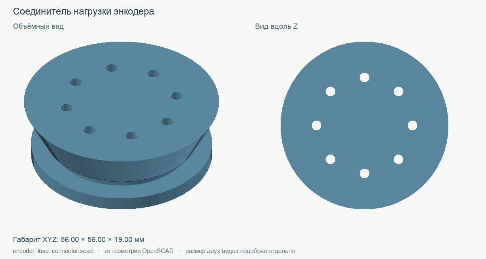

[Открыть деталь](docs/parts/encoder_load_connector.scad) · Источник: [reference_model.scad](docs/parts/reference_model.scad).

Вызов для отдельного файла:

```scad
load_connector_encoder();
```

Как построить: Построить reducer_connector() с высокой шейкой и юбкой. Оставить потаи через один по маске из восьми значений.

| Параметр | Значение в эталоне | Что задаёт |
| --- | --- | --- |
| `encoder_load_connector_h` | 15 | Высота шейки |
| `skirt` | true | Коническая юбка |
| `holes` | [1,0,1,0,1,0,1,0] | Маска потаев |
| `bearing_inner / D_out` | 40 / 70 | Диаметр шейки / габарит основания |

#### 18. Плата энкодера с компонентами

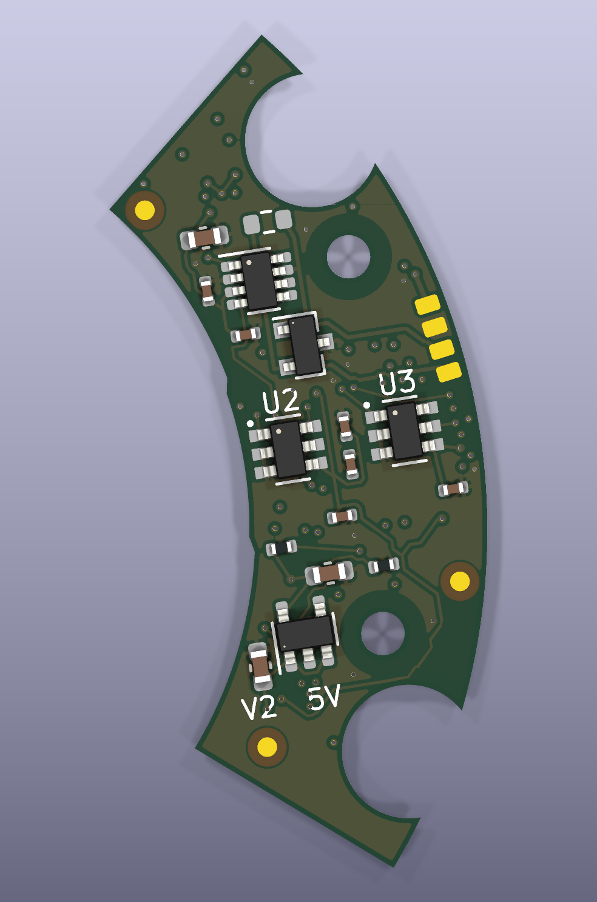

Вид из актуального проекта [KiCad CAN V2.4 / D70](electronics/encoder_can_v2/README.md), сторона Hall. Ниже — построение механического контура платы для сборки.

[Открыть деталь](docs/parts/encoder_pcb.scad) · Источник: [reference_model.scad](docs/parts/reference_model.scad).

Вызов для отдельного файла:

```scad
encoder_pcb_bare();
```

Как построить: Выдавить контур платы на её толщину и вычесть крепления. Для штатного Ø70 использовать сохранённый контур V2; для иных размеров строится параметрический макет.

| Параметр | Значение в эталоне | Что задаёт |
| --- | --- | --- |
| `encoder_pcb_h` | 0.8 | Толщина платы |
| `encoder_native_boundary` | из mechanics_v2.json | Штатный контур V2 |
| `encoder_native_mounts` | из mechanics_v2.json | Положение двух креплений |
| `encoder_pcb_span` | 80° / 160° | Штатный Ø70 / параметрический вариант |

### Детали ноги и корпуса

#### 19. Качалка плеча

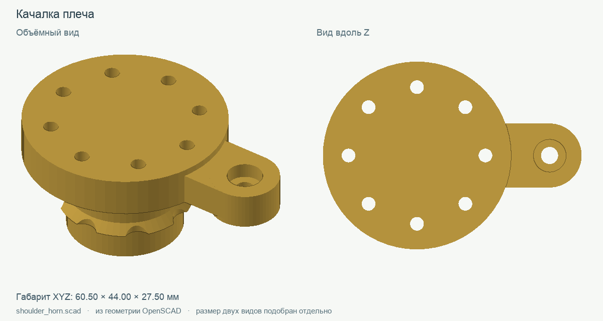

[Открыть деталь](docs/parts/shoulder_horn.scad) · Источник: [reference_model.scad](docs/parts/reference_model.scad).

Вызов для отдельного файла:

```scad
shoulder_horn();
```

Как построить: Объединить ступенчатую осевую втулку с площадкой рычага. Вырезать центральный проход, отверстия крепления и отверстие тяги на радиусе shoulder_horn_r.

| Параметр | Значение в эталоне | Что задаёт |
| --- | --- | --- |
| `shoulder_horn_r` | 31 | Радиус оси тяги |
| `shoulder_horn_h1 / shoulder_horn_h2` | 7 / 12 | Высоты основания / шарнирной части |
| `shoulder_bearing_id` | 25.05 | Наружная посадка осевой части |
| `shoulder_bearing_h` | 7 | Ширина опорного подшипника |

#### 20. Корпус плеча

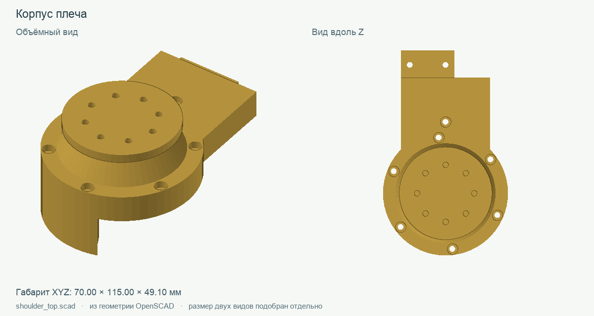

[Открыть деталь](docs/parts/shoulder_top.scad) · Источник: [reference_model.scad](docs/parts/reference_model.scad).

Вызов для отдельного файла:

```scad
shoulder_top();
```

Как построить: Объединить круглый корпус и прямоугольное продолжение. Вырезать сектор хода качалки, подшипниковую посадку, карманы стыка, отверстия штифтов и крепления. Добавить соединитель сверху.

| Параметр | Значение в эталоне | Что задаёт |
| --- | --- | --- |
| `shoulder_h` | 33 | Высота корпуса из высот качалки и подшипника |
| `D_out` | 70 | Диаметр круглой части |
| `shoulder_bearing_od` | 37 | Посадка подшипника |
| `cutting_wedge(angle=135)` | 135° | Сектор выреза; фиксирован в теле модуля |

#### 21. Основание бедра

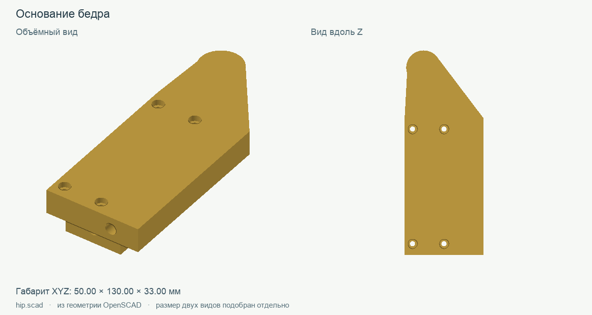

[Открыть деталь](docs/parts/hip.scad) · Источник: [reference_model.scad](docs/parts/reference_model.scad).

Вызов для отдельного файла:

```scad
hip();
```

Как построить: Сформировать продольную основу из блока и двух трапециевидных переходов. Добавить круглый конец колена, затем вырезать карманы, отверстия штифтов, винтов и ступенчатую посадку 688ZZ.

| Параметр | Значение в эталоне | Что задаёт |
| --- | --- | --- |
| `connect_rod_l` | 184 | Базовая длина тяги, влияет на бедро |
| `hips_l / hips_l1` | 109 / 87 | Производные длины |
| `shoulder_h` | 33 | Высота исходного блока |
| `point_foot_center_in_hip` | [12,119,20] | Локальный центр оси колена |

#### 22. Накладка бедра

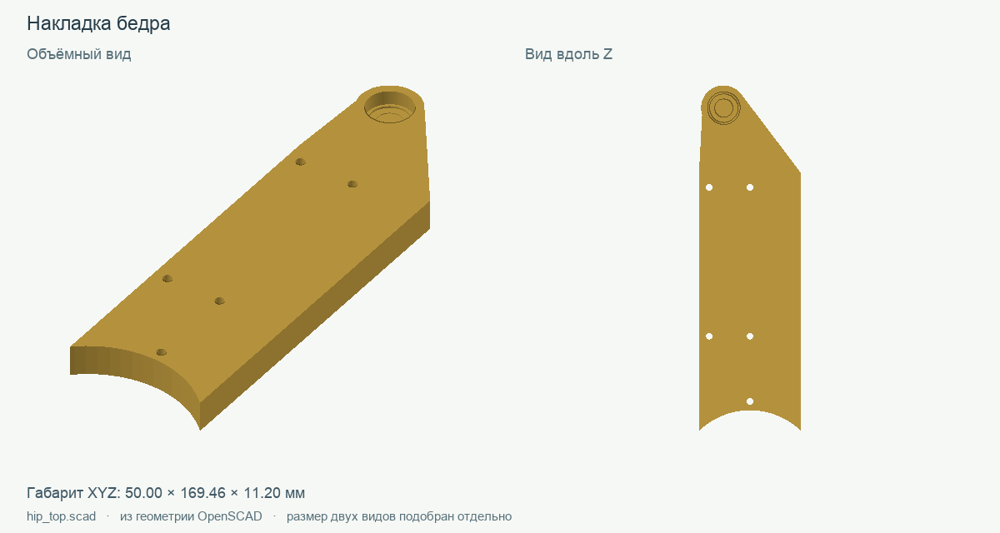

[Открыть деталь](docs/parts/hip_top.scad) · Источник: [reference_model.scad](docs/parts/reference_model.scad).

Вызов для отдельного файла:

```scad
hip_top();
```

Как построить: Объединить плоскую пластину, трапециевидный конец и бобышку колена. Вырезать сопряжение с плечом, ступенчатую посадку 688ZZ и отверстия крепления.

| Параметр | Значение в эталоне | Что задаёт |
| --- | --- | --- |
| `hips_l` | 109 | Основа длины пластины |
| `толщина` | 11.2 | Задана внутри модуля |
| `point_foot_center_in_hip` | [12,166,0] | Локальная ось колена этой детали |
| `D_out` | 70 | Размер выреза сопряжения с плечом |

#### 23. Шарнир колена без стопы

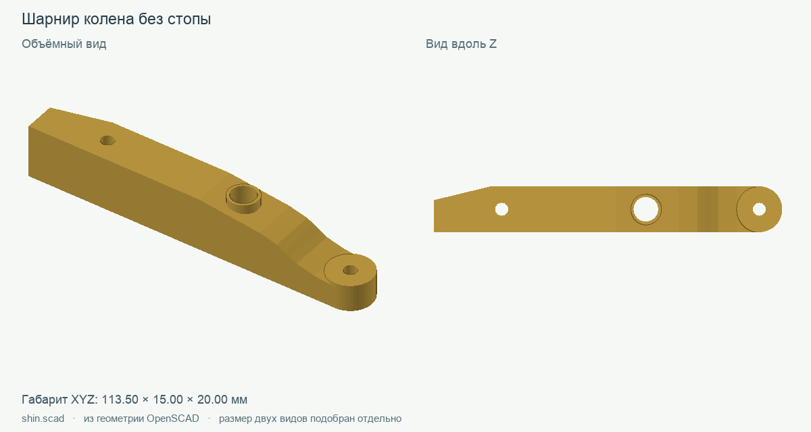

[Открыть деталь](docs/parts/shin.scad) · Источник: [reference_model.scad](docs/parts/reference_model.scad).

Вызов для отдельного файла:

```scad
shin(foot=false);
```

Как построить: Объединить втулки оси колена и тяги с перемычкой. Вырезать скосы исходной перемычки, продолжить её прямым языком под коннектор и срезать конец по форме посадочного паза. Просверлить оси и поперечный крепёж.

| Параметр | Значение в эталоне | Что задаёт |
| --- | --- | --- |
| `foot` | false | Аргумент: показать отдельно шарнир |
| `foot_r` | 37 | Плечо тяги |
| `shoulder_horn_h1 / shoulder_horn_h2` | 7 / 12 | Высота перемычки и бобышек |
| `h_joint_width / h_joint_depth` | 15 / 18 | Сечение вставляемого языка; в output/foots_h.scad |
| `h_joint_end` | 22 | Конец языка в системе коннектора |

#### 24. Тяга колена

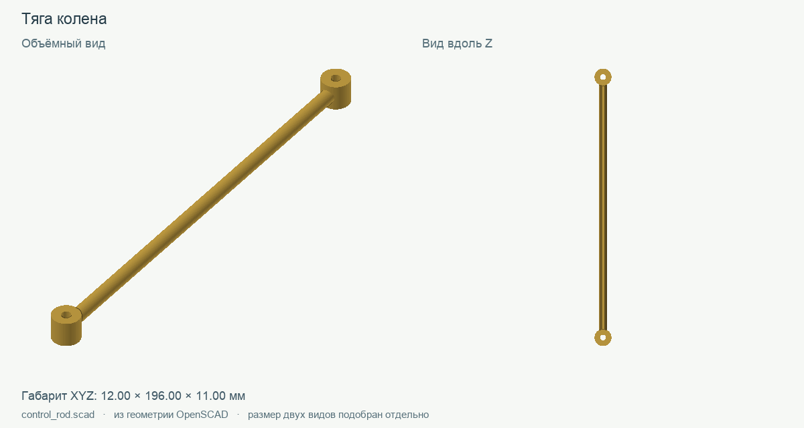

[Открыть деталь](docs/parts/control_rod.scad) · Источник: [reference_model.scad](docs/parts/reference_model.scad).

Вызов для отдельного файла:

```scad
connect_points_rod([0,0,0],[0,184,0],diameter=6,plate_thickness=11);
```

Как построить: Соединить две точки цилиндрической тягой. На концах добавить дисковые проушины Ø12 и вычесть сквозные отверстия Ø4 перпендикулярно плоскости механизма.

| Параметр | Значение в эталоне | Что задаёт |
| --- | --- | --- |
| `p1 / p2` | [0,0,0] / [0,184,0] | Аргументы: центры проушин |
| `diameter` | 6 | Аргумент: диаметр стержня |
| `plate_thickness` | 11 | Аргумент: толщина проушин |
| `hole_diameter` | 4 | Внутренняя константа отверстий |

#### 25. Голень H-профиля с коннектором

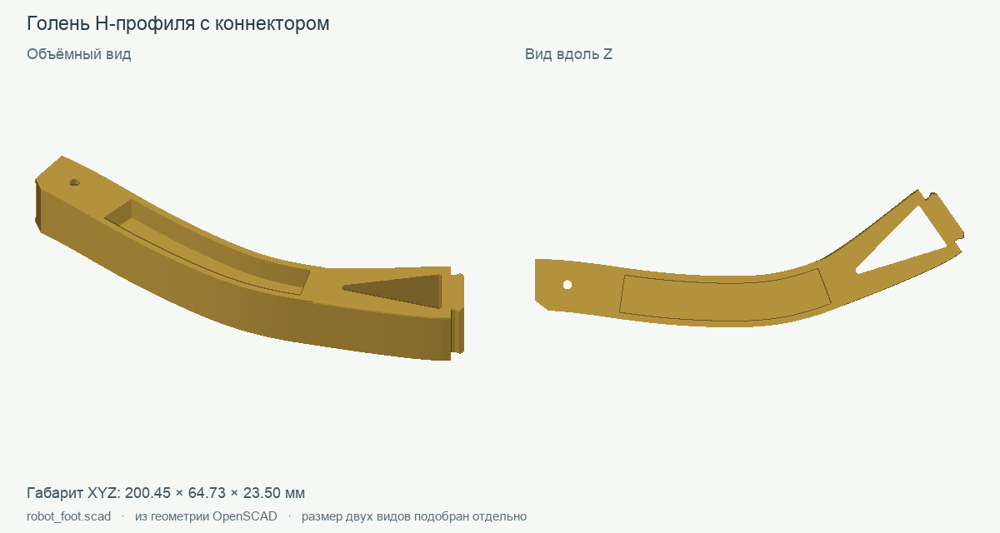

[Открыть деталь](docs/parts/robot_foot.scad) · Источник: [foots.scad](output/foots.scad).

Вызов для отдельного файла:

```scad
rigid_print();
```

Как построить: Протянуть постоянный H-профиль вдоль двух сопряжённых кривых Безье. Объединить с изогнутым наружным корпусом коннектора; вычесть прямой посадочный паз и отверстие крепежа. Внизу сформировать развилку с треугольным окном и опору под TPU.

| Параметр | Значение в эталоне | Что задаёт |
| --- | --- | --- |
| `h_length` | 145 | Продольная проекция основной стойки |
| `h_width / h_depth` | 24 / 23.5 | Постоянное сечение |
| `h_flange / h_web` | 3.2 / 3.2 | Толщина полок / перемычки |
| `h_root_angle / h_reverse_drop / h_toe_rise` | −8° / 6 / 26 | Параметры изгиба |
| `h_joint_clearance` | 0.15 | Зазор паза на сторону |

#### 26. TPU-основание стопы

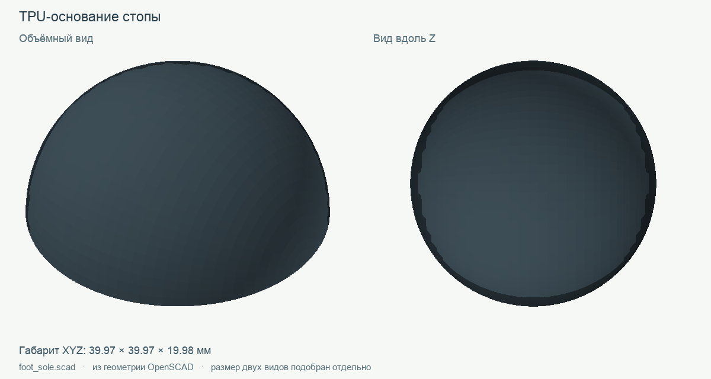

[Открыть деталь](docs/parts/foot_sole.scad) · Источник: [foots.scad](output/foots.scad).

Вызов для отдельного файла:

```scad
sole_print();
```

Как построить: Отсечь полусферическую рабочую поверхность и вычесть посадочную полость под жёсткую опору. Внутренние скосы закрывают полость под 45°. Открытым монтажным срезом поставить деталь на Z=0.

| Параметр | Значение в эталоне | Что задаёт |
| --- | --- | --- |
| `h_pad_radius` | 20 | Радиус полусферы |
| `h_gap` | 0.30 | Посадочный зазор на сторону |
| `h_sole_lift` | 0.30 | Торцевой зазор до жёсткой опоры |
| `h_pad_angle` | 35° | Ориентация посадки в собранной стопе |

#### 27. Корпус робота

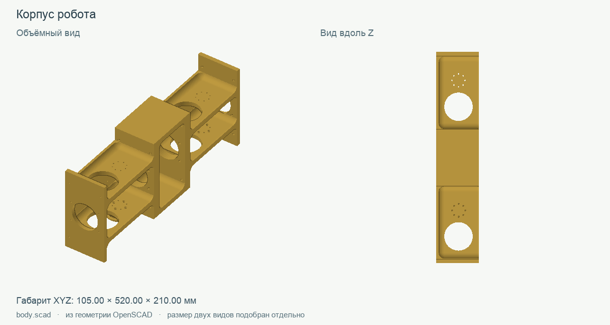

[Открыть деталь](docs/parts/body.scad) · Источник: [reference_model.scad](docs/parts/reference_model.scad).

Вызов для отдельного файла:

```scad
body(parts=false);
```

Как построить: Собрать передний и задний несущие узлы из стенок с отверстиями, соединить центральной секцией аккумулятора и добавить соединитель. Флаг parts=false скрывает импортированные приводы и ногу.

| Параметр | Значение в эталоне | Что задаёт |
| --- | --- | --- |
| `parts` | false | Аргумент: показать только корпус |
| `расстояние узлов` | 320 | Задано translate() внутри body() |
| `a1 / a2` | 0 / 0 | Аргументы позы добавляемой ноги при parts=true |
| `h / w / d / l` | в модулях стенок | Габариты локальных секций; проверить сопряжения при изменении |

#### 28. Площадка осевого энкодера

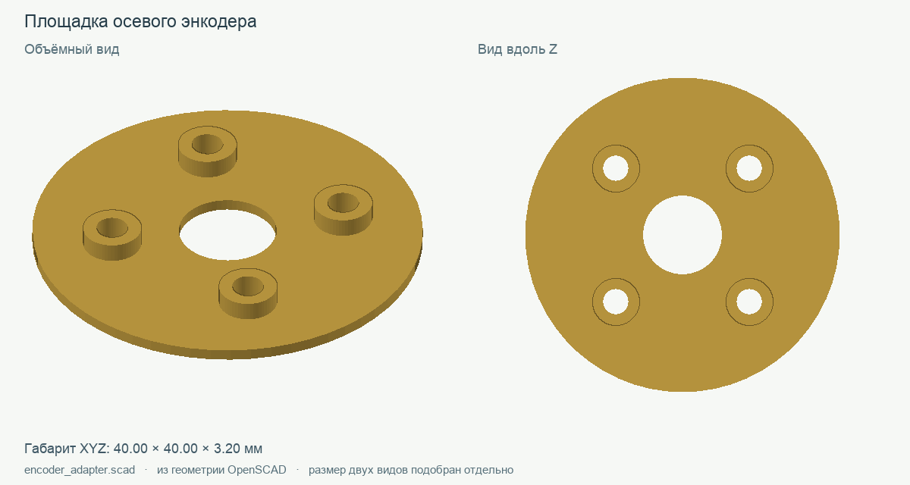

[Открыть деталь](docs/parts/encoder_adapter.scad) · Источник: [reference_model.scad](docs/parts/reference_model.scad).

Вызов для отдельного файла:

```scad
encoder_adapter(h=1.2);
```

Как построить: Создать диск и четыре стойки вокруг оси. Просверлить центральное отверстие и четыре отверстия крепления. Это отдельный вариант для осевого датчика MT6816/XJX-135.

| Параметр | Значение в эталоне | Что задаёт |
| --- | --- | --- |
| `h` | 1.2 | Аргумент: толщина площадки |
| `mc_motor_plate_d` | 50 | Радиус диска = plate_d/2 − 5 |
| `mc_nut_pad_radius` | 24 | Диаметр окружности центров стоек в данном модуле |
| `mc_encoder_hole_d` | 10 | Центральное отверстие |

#### 29. Держатель магнита осевого энкодера

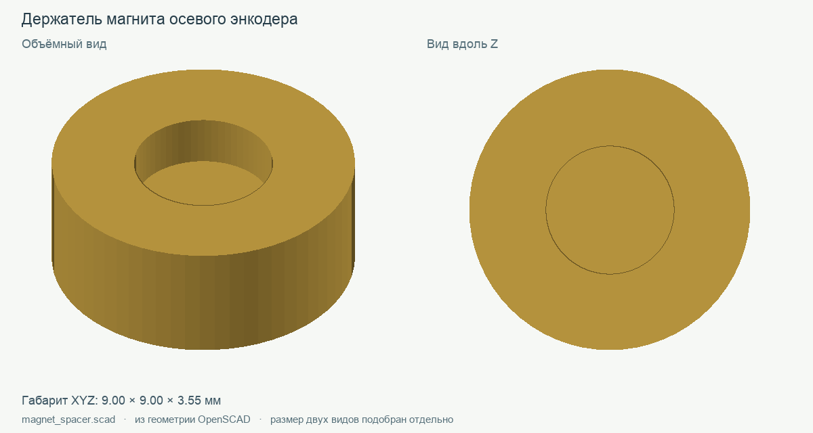

[Открыть деталь](docs/parts/magnet_spacer.scad) · Источник: [reference_model.scad](docs/parts/reference_model.scad).

Вызов для отдельного файла:

```scad
rsgl_magnet_spacer();
```

Как построить: Создать цилиндр-бочонок. Снизу вычесть отверстие под вал, сверху — гнездо магнита; сохранить перемычку между полостями.

| Параметр | Значение в эталоне | Что задаёт |
| --- | --- | --- |
| `d` | 9 | Аргумент: наружный диаметр |
| `val_dia / val_clearance` | 3.97 / 0.13 | Аргументы: диаметр вала / прибавка к диаметру |
| `magnet_dia / mag_clearance` | 4.01 / 0.1 | Аргументы: магнит / прибавка к диаметру гнезда |
| `magnet_height / bottom_thickness / val_height` | 1.5 / 1 / 1 | Аргументы: магнит / толщина основания / осевая прибавка |

### Сборочные режимы редуктора с энкодером

После генерации можно менять `generated_part` в самой модели либо передавать
`-D 'generated_part="encoder_section"'` через CLI OpenSCAD. В файле с `use` удобнее
вызвать `encoder_selected_part("encoder_section");`.

| Режим `--part` / `generated_part` | Что показать | Какие параметры использовать |
| --- | --- | --- |
| `legacy` | Исходная сборка и модули робота | Комментировать вызовы в секции «Сборка», либо открыть одну из карточек |
| `encoder_assembly` | Сборка доработанных деталей редуктора с энкодером | `encoder_assembly(with_bracing=true,show_electronics=true,show_magnets=true)` |
| `encoder_section` | Разрез сборки | `encoder_assembly(section=true)` |
| `encoder_exploded` | Разнесённая сборка | `encoder_assembly(exploded=true)` |
| `encoder_cap` | Крышка редуктора под установку энкодера | `cap_encoder(with_bracing=true)` |
| `encoder_lid` | Защитная накладка крышки редуктора с переносом к Z=0 | `encoder_selected_part("encoder_lid")` |
| `encoder_print` | Крышка редуктора и её защитная накладка рядом | `encoder_selected_part("encoder_print")` |
| `encoder_clamp` | Доработанный зажим соединителей с носителями магнитов | `connector_clamp_encoder(show_magnets=true)`; магниты — фоновые объекты просмотра |
| `encoder_clamp_half` | Корпус полузажима соединителей под энкодер | `connector_clamp_encoder_body_half()`; для печатной ориентации — `encoder_clamp_body_for_print()` |
| `encoder_magnet_ring` | Две половинки носителя магнитов плашмя | `encoder_magnet_ring_for_print()`; одна — `encoder_magnet_ring_half_for_print()` |
| `encoder_clamp_print` | Корпуса полузажимов и носители в печатном положении | `encoder_selected_part("encoder_clamp_print")` |
| `encoder_connector` | Выходной соединитель редуктора под энкодер | `reducer_connector_encoder()` |
| `encoder_load_connector` | Соединитель нагрузки редуктора под энкодер | `load_connector_encoder()` |
| `encoder_pcb` | Механический контур платы | `encoder_pcb_bare()`; это не электрическая разводка |

Изображения обновляются скриптом [render_catalog.py](docs/parts/render_catalog.py).
Подробности воспроизведения — [docs/parts/README.md](docs/parts/README.md).

## Управление сборкой

Внизу, в секции "Сборка", перечисляются детали, можно их создание раскомментировать и подвигать функцией translate:

```
// === Сборка ===
rigid_gear_with_bracing();  // Корпус с боковым креплением
translate([0, 0, h_reducer+1]) cap_with_bracing();  // Крышка с боковым креплением
translate([0, 0, 0.5]) eccentric_shaft();
translate([0, 0, 14]) rotate([180,0,0]) eccentric();
translate([0, 0, ecc_shaft_h1 + ecc_spacer_h-1]) separator();
translate([0, 0, -mc_total_height-1]) motor_cover(); // кожух снизу
```

## Параметры моделирования

Параметр $fn отвечает за разрешение геометрии модели:
```
// ВПТК редуктор с роликами

$fn = 60;  // Рекомендуемое значение для 3D печати
```

В редакторе OpenSCAD есть кнопки рендеринга и экспорт в STL.

## Параметры, запрашиваемые при запуске

- **Количество точек построения профиля жесткого колеса** (по умолчанию: 600) - влияет на точность профиля
- **Передаточное число** (по умолчанию: 19) - основной параметр передачи
- **Диаметр роликов (мм)** (по умолчанию: 4.0) - диаметр роликов сепаратора
- **Высота роликов (мм)** (по умолчанию: 5.0) - высота роликов сепаратора
- **Внешний радиус впадин жесткого колеса (мм)** (по умолчанию: 28.0) - радиус профиля жесткого колеса
- **Внешний диаметр редуктора (мм)** (по умолчанию: 70.0) - общий диаметр корпуса

## Список деталей и крепежа

Программа автоматически выводит список всех необходимых деталей и крепежа, включая:
- Подшипники: 6803ZZ (17×26×5 мм), 688ZZ (8×16×5 мм), и подшипник для сепаратора (6808-2RS или 6810-2RS)
- Винты: M3×10 мм и M3×15 мм
- Гайки: M3

## Робот-собака: стопа, ходьба и бег

Текущая печатная голень со стопой, шаг **200 мм** и последовательная сборка:
одна нога → левая пара → четыре ноги с корпусом → бег. GIF замедлены:
**12 секунд на цикл**, круговой облёт — **48 секунд** на четыре цикла.
Направление вперёд в боковом виде — влево. Номера стоп помогают следить за ногами.
Модели OpenSCAD и настройки — в [описании стопы](output/foot/README.md).

<details>
<summary>1. Одна нога · шаг 200 мм</summary>

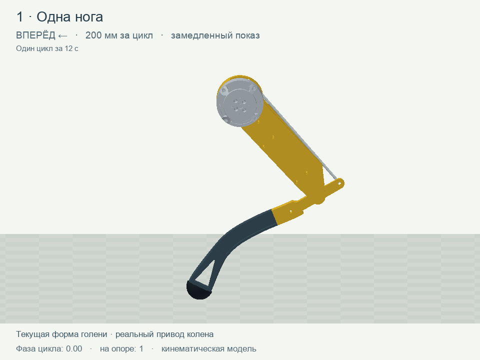

</details>

<details>
<summary>2. Левые передняя и задняя</summary>

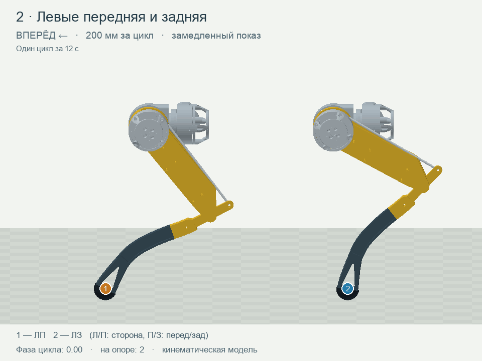

</details>

<details open>
<summary>3. Четыре ноги с исходным корпусом</summary>

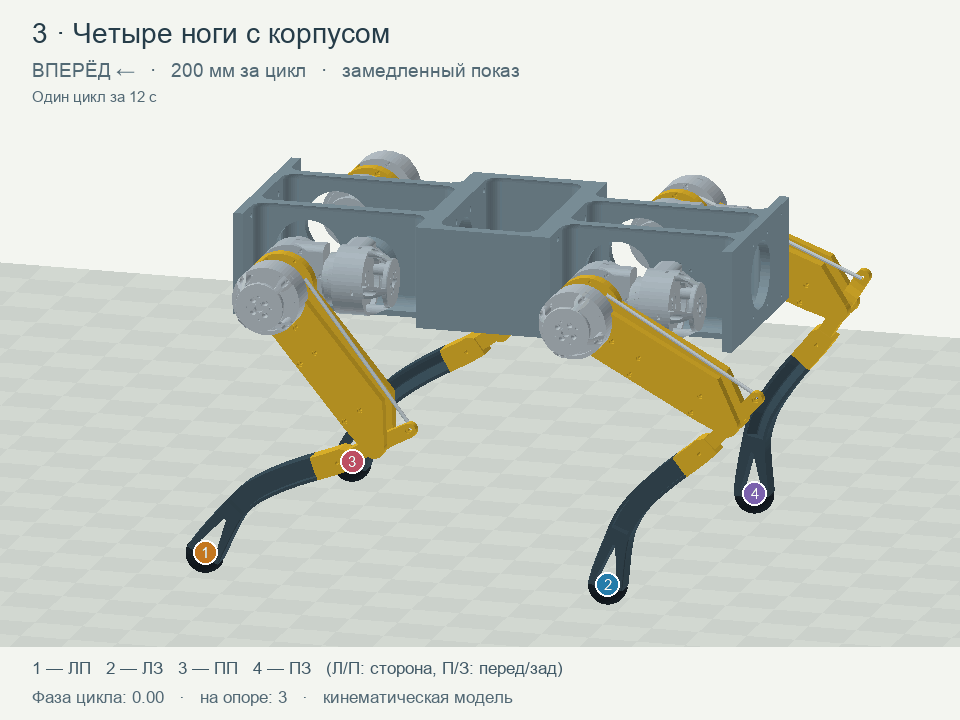

</details>

<details>
<summary>4. Бег диагональными парами</summary>

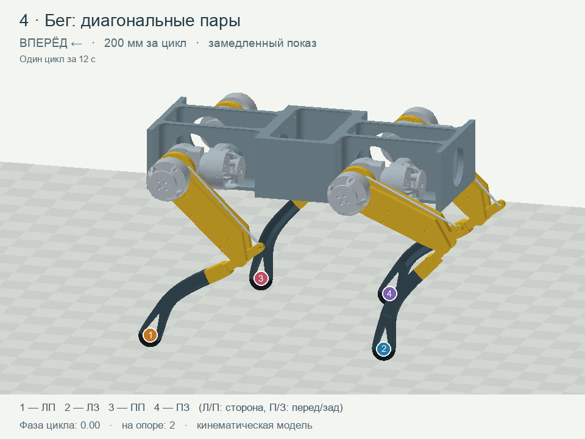

</details>

<details>
<summary>5. Бег с круговым облётом камеры</summary>

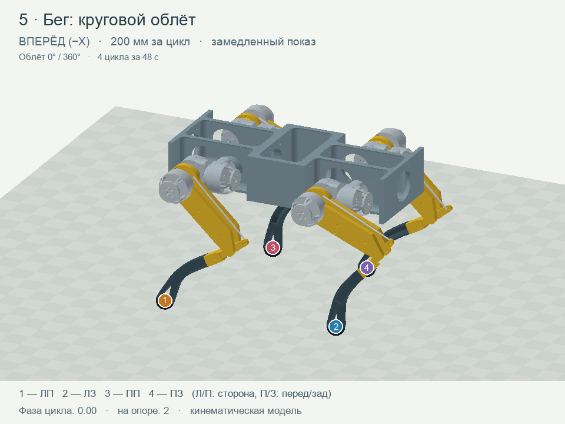

</details>
