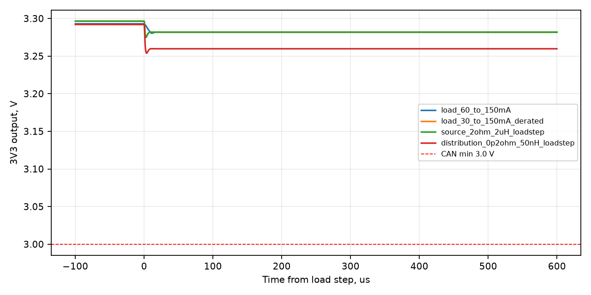
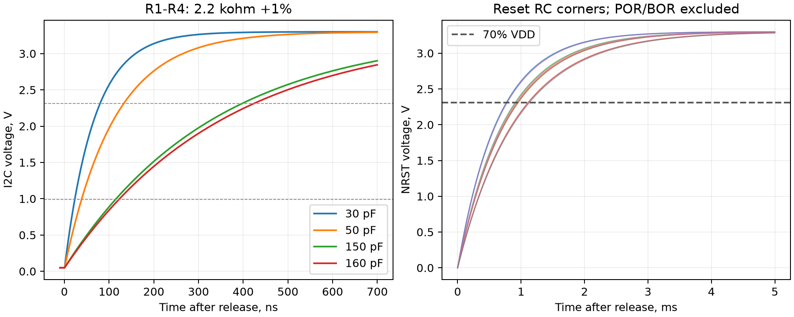

# Симуляции V2 в KiCad, 16.10.2026

Выполнены новые расчёты для текущей V2 на штатной библиотеке ngspice 45.2 из установленного KiCad 10.0.7. Номиналы и соединения каждого компонента сверены с XML, заново экспортированным из схемы. Плата и производственная схема при проверке не изменялись. Хеши источников — в `source_check.json`.

Подготовлены 11 нативных схем KiCad, каждая экспортирована штатным KiCad в SPICE и запущена его расчётным движком. Режим совместимости соответствует PSpice в KiCad (`ngbehavior=psa`). Результаты завершённых расчётов совпали с прямыми прогонами. Проверка — `kicad/native_verification.json`.

После разблокировки Mac дополнительно выполнен расчёт **прямо в окне симулятора KiCad**: 30→150 мА, входной источник 4,5 В, уменьшенные ёмкости. Расчёт завершился до 12 мс; экспортированный из GUI CSV содержит 60160 точек. Во время нагрузочного события напряжение у нагрузки **3,27491–3,30342 В**; отличие экстремумов от пакетного расчёта меньше 47 мкВ. Сохранены `kicad/load_30_to_150mA_derated.wbk`, график `kicad/load_step_gui.png`, данные `kicad/load_step_gui.csv` и `kicad/gui_verification.json`. График оставлен открытым в симуляторе.

## Результат

Восемь рабочих сценариев питания до 150 мА проходят принятый критерий 3,0–3,6 В после запуска. Это результат типовой модели при заданных ёмкостях, нагрузках и сосредоточенных R/L; параметры дорожек из геометрии PCB не извлекались.

| Сценарий | Напряжение у условной нагрузки во время события |
|---|---:|
| 60→150 мА, уменьшение ёмкости от смещения напряжением | 3,2803–3,2945 В |
| 30→150 мА за 1 мкс, вход 4,5 В, уменьшенные ёмкости | 3,2749–3,3035 В |
| Вход 5→4,5 В, нагрузка 150 мА | 3,2817–3,2821 В |
| Источник с 2 Ом и 2 мкГн, скачок 30→150 мА | 3,2749–3,3034 В |
| Распределение питания 0,2 Ом и 50 нГн, скачок 30→150 мА | 3,2539–3,2979 В |

В отличие от прежнего расчёта V1, вся эквивалентная нагрузка здесь приложена после сопротивления и индуктивности распределения питания; контролируются и выход LDO, и напряжение у нагрузки. По умолчанию распределение задано как 0,05 Ом и 5 нГн; дополнительный сценарий — 0,2 Ом и 50 нГн. Это проверка чувствительности, не измеренные параметры платы. Номинальные выходные ёмкости: C11 = 4,7 мкФ, остальные конденсаторы непосредственно между 3,3 В и GND суммарно 7,21 мкФ. В уменьшенном сценарии — 1,65 и 2,765 мкФ соответственно; это принятые допущения, не гарантированные минимумы партии.

Шаг расчёта питания 200 нс; уточнение до 50 нс для скачка 30→150 мА меняет минимум/максимум у нагрузки менее чем на 56 мкВ. Таблицы — `power/results/summary.json` и `convergence.json`.

Для R1–R4 = 2,2 кОм проверены 20 вариантов RC-модели четырёх линий I²C. При предполагаемых 50 пФ фронт 30–70% занимает 94,1 нс, при 150 пФ — 282,4 нс: меньше предела Fast-mode 300 нс. При 160 пФ получается 301,2 нс, этот вариант не проходит. Ёмкости заданы для чувствительности; реальная ёмкость линий не извлечена. Эквивалентный ключ с 33 Ом не является транзисторной моделью STM32 или TMAG5273. Подтяжки при 3,6 В и допуске −1% дают не более 1,653 мА. Проверки согласуются с независимой формулой RC; это не проверка обмена данными или настройки TIMINGR. [NXP UM10204, таблица 11](https://cache.nxp.com/docs/en/user-guide/UM10204.pdf), [TMAG5273, §5.3/5.5](https://www.ti.com/lit/ds/symlink/tmag5273.pdf).

Для NRST выполнено восемь сочетаний: R6 ±1%, C12 ±10%, внутренняя подтяжка 25–55 кОм. После отпускания сброса при установившихся 3,3 В время достижения 70% питания — 0,768–1,130 мс. POR/BOR, прошивка и удержание NRST внутри MCU не моделировались. [STM32G431, таблица 57 и рис. 27](https://www.st.com/resource/en/datasheet/stm32g431kb.pdf).

## Что не прошло или осталось открытым

- Полное отключение питания на 50 мкс: расчёт обрывается около 5,042 мс при VIN ≈0,895 В с `timestep too small`. Частичные волны сохранены для диагностики. Успешный перезапуск, минимум питания и восстановление этим расчётом не подтверждены.
- Падение входа до 3 В: модель завершилась, напряжение у нагрузки падает примерно до 2,827 В, ниже рабочего питания CAN. Это аварийный сценарий за пределами заданного входного диапазона 4,5–5,5 В.
- Нагрузка 350 мА: модель завершилась, но ток превышает паспортные 300 мА. Этот прогон не считается рабочим проходом, температурной модели нет.
- Медленный входной фронт 5 мс: средняя скорость выхода 10–90% около 1,55 В/мс. Для TMAG5273 при использовании sleep/wake нужно соблюдать процедуру из §5.3 после медленного включения. Для standby/continuous эта оговорка TI не требуется. Средняя скорость не проверяет мгновенную производную на всём фронте. [Условия TMAG5273](https://www.ti.com/lit/ds/symlink/tmag5273.pdf).
- Типовая модель LDO, эквивалентная нагрузка и RC-цепи не проверяют исполнение программы STM32, обмен CAN, преобразования Hall, запуск кварца, нагрев, ESD/EMC или точность абсолютного угла. Полная схема платы с работой всех микросхем не симулировалась.

## Модель стабилизатора

Использована официальная [TI SBVM961 TPS7A20](https://www.ti.com/lit/zip/sbvm961) с V_out=3,3. Исходный файл сохранён в `power/vendor/SBVM961`; адаптированная копия — рядом. В ключе S2 переставлены пары Ron/Roff и Von/Voff для совместимости с ограничителем ngspice. Нижнее сопротивление ограничивается 1 мОм вместо 1 мкОм; переходная характеристика тоже меняется. Адаптация не является точным эквивалентом PSpice и не задаёт гарантированные предельные параметры TPS7A2033PDBVR.

Заново выполнены проверка установившегося выхода 3,3 В, сравнение характеристик ключа и контроль trapezoidal/gear; данные — `power/diagnostics/port_validation.json`. TI явно исключает температуру и собственный ток потребления. Эти ограничения не позволяют считать расчёт квалификацией изготовленной платы.

## Открыть в KiCad

1. Открыть, например, `kicad/load_30_to_150mA_derated.kicad_pro`, затем одноимённую схему.
2. Открыть **Inspect → Simulator**. В проекте задан режим совместимости **PSpice**; при необходимости выбрать его в настройках анализа.
3. Открыть сохранённую рабочую книгу `load_30_to_150mA_derated.wbk` либо создать анализ TRAN по директиве `.tran 0.2u .012 0 0.2u`, запустить расчёт и выбрать `V(REMOTE)`, `V(VOUT)`, `V(VIN)`.

X1 на тестовой схеме — весь явно описанный измерительный стенд питания: модель LDO, конденсаторы, R/L и электронная нагрузка. Это не микросхема платы. Полный текст схемы находится в локальном файле `kicad/bench_models/*.lib`; все эти модели включены в комплект. Для интерфейсов доступны отдельные файлы `interfaces/i2c.cir` и `reset.cir`.

Логи и экспортированные `.cir` в `kicad/exported` фиксируют выполненный расчёт с абсолютными путями данной машины. Для повторения на другом компьютере следует экспортировать нативные `.kicad_sch` заново; их ссылки на модели относительные. Основная схема энкодера не заменена тестовой схемой.

Для повторного пакетного расчёта нужны установленный KiCad, Python с NumPy/Matplotlib: сначала `run_interfaces.py`, затем `power/run_power.py`, `power/validate_port.py`, `power/verify_convergence.py`, `build_kicad_benches.py`, `verify_native_benches.py`. Пути к установленному KiCad на macOS заданы в коде. Плотные волны сохранены в `power/results/full_waveforms.zip` как NPZ с именами векторов; частичный расчёт отключения имеет собственное имя и не считается завершённым.

Сведения о движке, подключении моделей и запуске анализа: [официальная документация KiCad 10](https://docs.kicad.org/10.0/en/eeschema/eeschema.html#_simulator).
