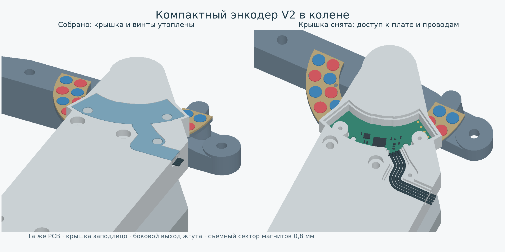
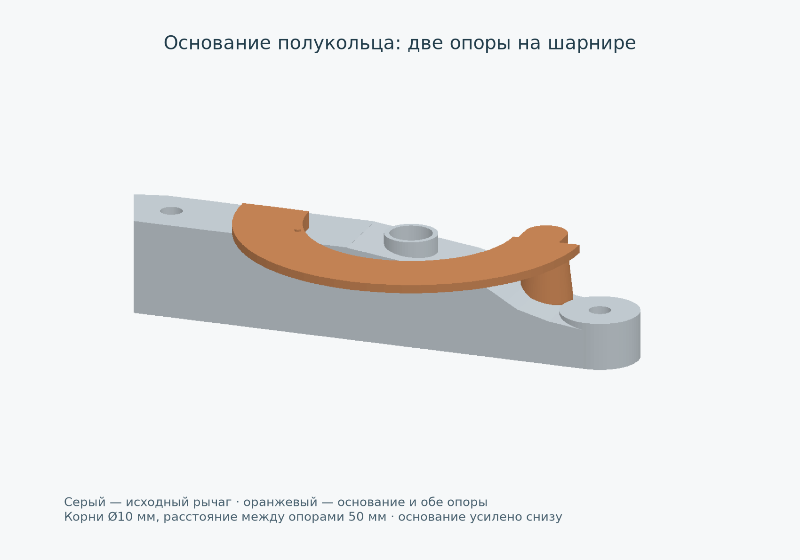

# Установка универсальной платы V2 в колене

Актуальная механическая компоновка от **21.10.2026**.
Открыть **`knee_encoder_compact.scad`** в OpenSCAD. Используется существующая
разведённая плата `electronics/encoder_can_v2/encoder_can_v2.kicad_pcb`:
контур, отверстия, компоненты, радиусы Hall 23,5/29,5 мм и сама PCB не изменены.

Прежние пути `../knee_encoder_compact.scad` и `../knee_encoder_layout.scad`
также открывают эту модель. У всех трёх файлов собственные одинаковые поля
управления для панели настройки OpenSCAD; общая геометрия и кинематика
находятся в `knee_encoder_scene.scad` и подключаются через `include`.
Старые макеты сохранены в `../revisions/2026-10-21-before-v2-entrypoints/`.



## Габариты и устройство

Плата повёрнута относительно исходного макета на 7° к телу щеки:
`board_rotation=-81°`, направление чувствительных точек −72°.
Положение подобрано по площади добавленного контура, а не только по
прямоугольному габариту платы. Сравнение с прежними наружными ушами —
`profile_comparison.png`.

Крышка толщиной **2 мм** утоплена в карман: её наружная плоскость совпадает
с исходной щекой, Z=23,5 мм. Головки винтов заканчиваются на Z=23,4 мм.
Прежние 0,8 мм крышки и 1,3 мм головок над щекой убраны — выигрыш по высоте
**2,1 мм**. По краю гнезда оставлен бортик 1,2 мм и зазор крышки 0,2 мм.

Два винта крышки расположены в свободных вырезах PCB, третий — в плоской
кабельной части внутри исходного корпуса. Отдельных наружных стоек больше нет.
PCB опирается на два штатных монтажных кольца, центрируется штифтами Ø1,8 мм
и прижимается стойками крышки Ø3,8 мм. Оси и посадки подшипников сохранены.

Крепёж крышки: **3 винта M2×6 с низкой головкой Ø3,8 × 1,3 мм**, без шайб.
Проверенный справочный габарит —
[NBK SLH-M2-6](https://static.nbk1560.com/en/products/specialscrew/nedzicom/miniaturescrew/SLH/SLH-M2/SLH-M2-6/).
В крышке отверстия Ø2,2 мм и карманы Ø4,2 × 1,4 мм; под головками остаётся
0,6 мм пластика. Пилоты в щеке Ø1,6 мм, глубиной 6,2 мм; винт входит в пластик
примерно на 5,4 мм. Диаметр пилота и усилие затяжки нужно проверить на образце
своего пластика. Посадок под термовставки в этом варианте нет.

## Датчики и магниты

Плата расположена на Z=15,75…16,55 мм. На стороне магнитов вычтены отдельные
карманы по фактическим габаритам компонентов. Между карманами дно толще,
чем прежняя сплошная мембрана 0,4 мм.

В точках обоих Hall проверены реальные поверхности модели:

| Поверхность | Z, мм |
|---|---:|
| Передний торец магнита | 13,3 |
| Наружная сторона защитного окна | 13,7 |
| Внутренняя сторона окна | 14,1 |
| Нижний габарит корпуса датчика | 14,3 |
| Передняя сторона PCB | 15,75 |

Получаются **0,4 мм воздуха + 0,4 мм пластика + 0,2 мм монтажного зазора**
до габаритной оболочки датчика. Расчётное расстояние до Hall-точки
1,78…2,28 мм осталось прежним; это геометрический диапазон, а не оценка
точности измерения.

Магнитный сектор теперь отдельный: **0,8 мм**, 25 сквозных отверстий Ø5,2 мм
для магнитов Ø5×1 мм — 12 во внутренней дорожке и 13 во внешней. Печатается
плашмя; глухих донышек в ячейках нет. Полукольцо занимает −180…0°:
оба края приходятся на продольную ось шарнира голени. Площадка под ним
имеет ту же ориентацию. Сектор ложится на ровную площадку
голени Z=12,3 мм. Один штифт Ø1,2 мм входит в отверстие Ø1,6 мм и задаёт
положение при приклейке. После установки магниты выступают над сектором
на 0,2 мм; их осевые положения и чередование полюсов сохранены.

Основание печатается заодно с подвижным рычагом. Оно соединено с ним
**двумя разнесёнными опорами** при X=−25 и +25 мм: корни Ø10 мм,
верхние части Ø8 мм. Левая опора входит в высокое плечо до Z=7 мм;
правая доходит до низкого наклонного плеча на Z=−1 мм. Она смещена на +Y
и соединена с основанием верхней косынкой, обходя тягу. Расширенные переходы
распределяют нагрузку по большей площади, чем прежняя одиночная перемычка.

Внутренняя часть основания утолщена вниз до **3,2 мм**; снизу сделан скос
к наружному краю толщиной 1,6 мм. Он оставляет просвет до ушка тяги.
Торец площадки под магниты, отдельный сектор 0,8 мм и воздушный зазор
остались на прежних высотах. Это геометрическое усиление;
прочность и ресурс печатной детали расчётом нагрузок не подтверждены.

Кольцевая выборка в неподвижной щеке имеет радиусы **19,5…33,5 мм**:
по обоим краям основания оставлено по 0,5 мм номинального радиального
зазора. Учитывая грани цилиндров OpenSCAD, при проверке 201 положения
требуется не менее **0,4 мм** между основанием с опорами и щекой.
Дополнительно проверяется кадр анимации `$t=0.27`, `knee_angle=0`
(угол рычага около 54,1835°).



Плата повёрнута, поэтому калибровку конкретного сустава выполнять после
окончательной сборки. Контроллер и PCB остаются общими с редуктором.
На проверенном ходе датчики остаются над сектором с угловым запасом
не менее 27,35° до его края. Это проверка геометрического покрытия;
точность магнитного измерения здесь не подтверждается.

## Проводка и обслуживание

Четыре провода с наружным диаметром изоляции **до 1 мм** выходят с J1
радиально за край платы, поднимаются внутри стенки и ложатся в открытый
сверху канал. Канал закрывает плоский хвост крышки. Выход — в боковую грань
щеки, ниже её наружной поверхности; изгиба жгута вверх над крышкой нет.
На рисунке показаны отдельные непересекающиеся провода с плавными изгибами.

Пайка выполняется до установки платы. За боковым выходом оставить сервисный
запас жгута около 30 мм и закрепить его на неподвижной части для разгрузки
пайки. Наружный жгут и его крепление зависят от общей проводки собаки.

J1 — четыре контакта питания и CAN. J2 — пять площадок клипсы 2,54 мм:
**5V, GND, SWDIO, SWCLK, NRST**. Прошивать и отлаживать удобнее на вынутой
плате: нижняя губка клипсы не помещается под установленную PCB.
[Инструкция программирования](../../../electronics/encoder_can_v2/PROGRAMMING.md).

Для обслуживания открутить три винта, поднять крышку, освободить жгут из
канала и поднять PCB с двух штифтов. Голень, ось, подшипники и нижняя щека
при этом остаются собранными.

## Порядок сборки

1. Напечатать щеку, голень с ровной площадкой, отдельный сектор и крышку.
   Примерить PCB без питания и проверить ход штифтов в её отверстиях.
2. Приклеить сектор к площадке голени по установочному штифту. Вклеить магниты
   с чередованием полюсов по каждой дорожке. Клей под магнитами не должен
   поднимать их над расчётным торцом.
3. Установить верхний подшипник. При снятой нижней щеке подвести голень
   **вдоль оси**, заведя сектор в кольцевую выборку. Сбоку через собранную
   вилку сектор не протаскивать.
4. Установить ось, нижний подшипник, нижнюю щеку и штатные детали тяги.
   Отдельный зажим текущей стопы показан самостоятельной деталью и не слит
   с печатной голенью. Проверить исходную механику до установки электроники.
5. Заранее прошить PCB и припаять четыре провода. Опустить плату снаружи
   датчиками к магнитам, укладывая нижний изгиб жгута в открытый карман.
6. Уложить провода в верхний канал и боковой выход. Надеть крышку и равномерно
   затянуть три M2×6, не выгибая PCB и не пережимая изоляцию.
7. Проверить свободный ход, питание и показания датчиков, затем выполнить
   калибровку сустава на собранной механике.

В OpenSCAD: `view="stage"`, `assembly_step=1…4` показывает этапы;
`view="exploded"` — разнесённую сборку; `view="section"` — разрез;
`view="mount"` — основание с обеими опорами, выделенное оранжевым;
`knee_angle` — поворот голени.

### Угол и анимация OpenSCAD

Для ручного поворота установить `animate=false`, менять `knee_angle` и
нажимать F5. Поворачиваются рычаг, основание, накладка с магнитами и зажим
стопы; тяга следует за рычагом. Это работает и в режиме `view="mount"`.

Для анимации оставить `animate=true`, включить **Вид → Анимировать** и
задать **FPS=10**, **Шагов=100**. Оба поля должны быть ненулевыми.
Время `$t` плавно проводит колено между −44,6458° и +54,204° и обратно;
при `$t=0` оно находится в положении, заданном `knee_angle`.
Переход между концом и началом цикла непрерывен.
Крышка, PCB и корпус остаются неподвижными.

Виды деталей для печати `hip_print`, `cover_print`, `ring_print`
не зависят от времени анимации и угла колена.

## Файлы для печати и воспроизведение проверки

Селекторы `view="hip_print"`, `"cover_print"`, `"ring_print"` располагают
соответствующие детали на Z=0. Крышка обращена наружной плоскостью к столу,
сектор лежит плашмя. Голень экспортируется отдельно через `view="shin"`.
Щеке и голени нужны настройки поддержек под их нависающими участками;
первую пробу делать со снятием поддержек и контролем окон 0,4 мм.

```sh
python3 output/knee_encoder/v2/verify_installation.py --export
python3 output/knee_encoder/v2/render_installation.py
```

Зависимости: OpenSCAD CLI, Python с numpy, trimesh, manifold3d;
для рисунков также matplotlib. Экспортированные STL, промежуточные CSG
и логи находятся в `build/` и не предназначены для Git.
`build/hip_print.stl`, `cover_print.stl`, `magnet_ring_print.stl` получаются
из проверенных сеток; `build/shin.stl` — модифицированная голень.

Результаты — `installation_checks.json`, с хешами исходников. Проверяются
замкнутость печатных тел, посадка PCB, крышки и проводки, крепёж,
две отдельные области объёмного соединения основания с исходным рычагом,
подъём PCB и крышки наружу на 0…20 мм, реальные сечения окон и
201 положение колена −44,6458…+54,204°. Для добавленного корпуса также
проверяется минимальный зазор основания до щеки и отдельно кадр `$t=0.27`;
проверяется непрерывный осевой зазор: вращение вокруг Z не меняет высоту
магнитов и нижнюю плоскость новых неподвижных деталей.

`dependency_equivalence.json` фиксирует совпадение всех 14 CSG-экспортов
с сохранёнными в Git версиями общих зависимостей. Дополнительные изменения
общего файла редуктора и прежней платы V1 не требуются для этой установки.
Их полные контрольные суммы могут отличаться от входов первоначального
`installation_checks.json`, хотя используемая геометрия совпадает.

Проверки относятся к номинальной CAD-установке энкодера. Они не подтверждают
прочность нагруженной щеки, деформации печати, точность пайки, магнитного
измерения или всю плечевую кинематику. В исходной осевой посадке ушко тяги
пересекается с коротким плечом рычага на 0,5 мм по Z (около 49,53 мм³).
Это пересечение одинаково с энкодером и без него; оно здесь не исправлено.
Осевые посадки тяги и её крепёж остаются частью исходной механики.
